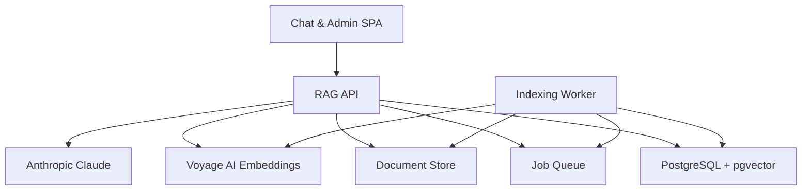
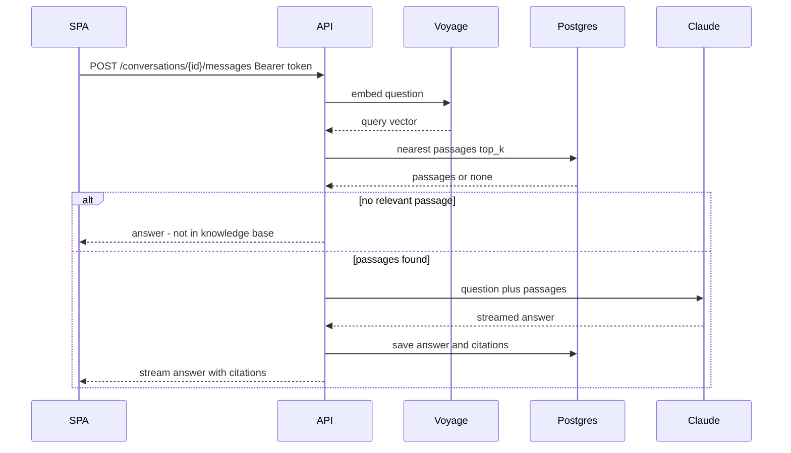
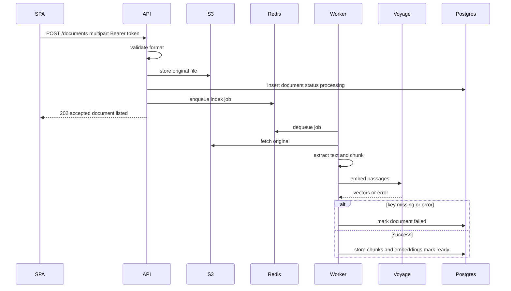
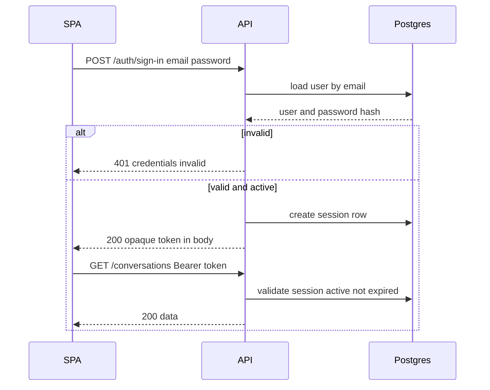
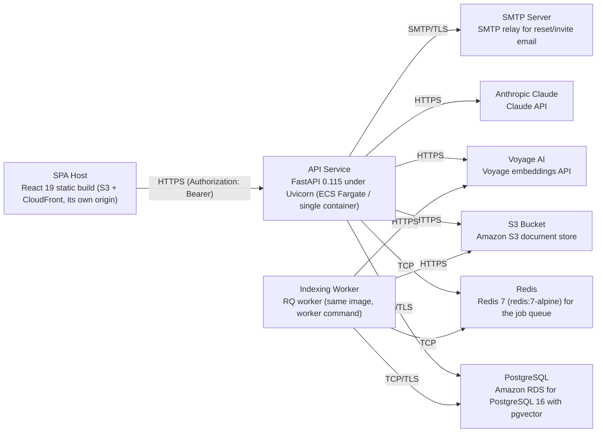

# Architecture

> Maintained by QuorQ AI SDLC. Text between `sdlc:auto` markers is regenerated; anything outside them is yours and is kept.

<!-- sdlc:auto:start narrative -->
## Overview

### ARCH-OVERVIEW · approved · source: architecture:summary

Lightweight RAG chatbot architecture for ~50 staff: React SPA, FastAPI API, Redis-backed indexing worker, PostgreSQL+pgvector, S3, Claude and Voyage AI, all in one AWS account/region.

A React 19 SPA (own origin) lets signed-in staff chat and lets admins upload/replace/delete documents. A FastAPI 0.115 API (separate origin) handles opaque-token server-side sessions, stores users, roles, conversations, document metadata and pgvector embeddings in one PostgreSQL 16 database, holds original files in S3, and orchestrates RAG answers (embed question via Voyage AI, nearest-passage search in pgvector, streamed cited Claude answer). A Redis-backed worker chunks/embeds documents asynchronously and purges chunks on replace/delete.

**Related:** REQ-TECH-STACK, REQ-SERVICES

### ARCH-COMP-WEB · approved · source: architecture:components.web

Chat & Admin SPA built in React 19.

Responsive chat interface, conversation history, admin document management, and sign-in. Stores the opaque session token and sends it as Authorization: Bearer on every API call; redirects unauthenticated users to sign-in.

**Related:** REQ-FEAT-SIGNIN, REQ-FEAT-ASKING, REQ-FEAT-HISTORY, REQ-FEAT-DOCMGMT

### ARCH-COMP-API · approved · source: architecture:components.api

RAG API built in FastAPI 0.115.

Handles authentication and session/token management, role checks, document upload to S3 and metadata, enqueuing indexing jobs, retrieval orchestration (embed question, vector search, call Claude), streaming cited answers, and per-user conversation history.

**Related:** REQ-FEAT-SIGNIN, REQ-FEAT-ASKING, REQ-FEAT-ANSWERS, REQ-FEAT-DOCMGMT, REQ-FEAT-HISTORY

### ARCH-COMP-WORKER · approved · source: architecture:components.worker

Indexing Worker: Python RQ worker on the FastAPI codebase.

Consumes Redis jobs: extract text from PDF/DOCX/TXT/MD, split into passages, embed each via Voyage AI, store embeddings in pgvector, mark document ready or failed; on replace/delete removes old chunks and embeddings.

**Related:** REQ-FEAT-INDEXING, REQ-FEAT-DOCMGMT

### ARCH-COMP-DB · approved · source: architecture:components.db

PostgreSQL 16 with pgvector extension is the single datastore.

Stores users, roles, sessions, conversations, messages, citations, document metadata, chunks and their vector embeddings; nearest-neighbour retrieval via pgvector.

**Related:** REQ-TECH-STACK

### ARCH-COMP-REDIS · approved · source: architecture:components.redis

Redis 7 (redis:7-alpine) job queue.

Durable background queue carrying chunk/embed and delete-cleanup jobs between the API and the worker.

**Related:** REQ-FEAT-INDEXING

### ARCH-COMP-S3 · approved · source: architecture:components.s3

Amazon S3 document store.

Durable storage of original uploaded PDF, Word, text and Markdown files for re-processing and opening the source behind a citation.

**Related:** REQ-FEAT-DOCMGMT

### ARCH-COMP-CLAUDE · approved · source: architecture:components.claude

Anthropic Claude API generates grounded, cited answers.

Generates grounded, cited answers (streamed) from the question and retrieved passages.

**Related:** REQ-FEAT-ANSWERS

### ARCH-COMP-VOYAGE · approved · source: architecture:components.voyage

Voyage AI Embeddings API turns text into vectors.

Turns document passages and user questions into vectors for retrieval.

**Related:** REQ-FEAT-INDEXING

### ARCH-CP-ASK · approved · source: architecture:critical_paths.ask

Critical path: ask a grounded, cited question.

A signed-in user submits a question; the API embeds it with Voyage, retrieves nearest passages from pgvector, and streams a Claude answer with citations into the same conversation. If no passage is relevant, it answers that the knowledge base has nothing on the topic; if Claude errors, an informative message is returned and the question stays for retry.

**Related:** REQ-FEAT-ASKING, REQ-FEAT-ANSWERS, NFR-006

### ARCH-CP-UPLOAD · approved · source: architecture:critical_paths.upload

Critical path: upload and index a document.

An admin uploads a supported file; the API validates format, stores the original in S3, records metadata as processing, and enqueues an indexing job. The worker extracts text, chunks it, embeds via Voyage, stores vectors, and marks the document ready; a missing key or provider error marks it failed with no partial document treated as ready.

**Related:** REQ-FEAT-DOCMGMT, REQ-FEAT-INDEXING, NFR-006

### ARCH-CP-SIGNIN · approved · source: architecture:critical_paths.signin

Critical path: sign in and protect requests.

Staff sign in with email and password; the API verifies the bcrypt hash, creates a server-side session, and returns an opaque token in the body. Every protected request carries Authorization: Bearer; the API validates the token, checks it is not expired/revoked and the account is active, and enforces the admin role on document management. Sign-out, inactivity expiry and admin deactivation all revoke the session.

**Related:** REQ-FEAT-SIGNIN, NFR-001, NFR-002, NFR-003

### ARCH-ENTITIES · approved · source: architecture:entities

Data model: users, sessions, documents, document_chunks, conversations, messages, message_citations.

- users: id, email, password_hash, role, is_active, created_at.
- sessions: id, user_id, token_hash, created_at, last_seen_at, expires_at, revoked_at.
- documents: id, name, format, s3_key, status, status_detail, uploaded_by, created_at, updated_at.
- document_chunks: id, document_id, chunk_index, content, embedding, created_at.
- conversations: id, user_id, title, created_at, updated_at.
- messages: id, conversation_id, role, content, created_at.
- message_citations: id, message_id, document_id, chunk_id, snippet.

**Related:** REQ-FEAT-SIGNIN, REQ-FEAT-HISTORY, REQ-FEAT-DOCMGMT, REQ-FEAT-INDEXING

### ARCH-EP-AUTH · approved · source: architecture:endpoints.auth

Authentication endpoints: sign-in, sign-out, current user, password-reset request.

- POST /auth/sign-in: authenticate by email and password; returns an opaque session token in the body; invalid credentials return 401 without revealing which field was wrong.
- POST /auth/sign-out: revoke the current session.
- GET /auth/me: return the signed-in user; SPA uses this to guard routes and redirect unauthenticated users.
- POST /auth/password-reset/request: send a password-reset email via SMTP for the given address (always 202, no account enumeration).

**Related:** REQ-FEAT-SIGNIN, NFR-001, NFR-002, NFR-003

### ARCH-EP-CONV · approved · source: architecture:endpoints.conversations

Conversation endpoints: list, start, read, and submit messages.

- GET /conversations: list the signed-in user's own saved conversations.
- POST /conversations: start a new conversation for the signed-in user.
- GET /conversations/{id}: return a conversation with its messages and citations; only the owner may read it.
- POST /conversations/{id}/messages: submit a question; retrieves passages, calls Claude, and streams a grounded answer with citations into the thread; returns an informative error if Claude is unavailable, leaving the question in the conversation.

**Related:** REQ-FEAT-ASKING, REQ-FEAT-ANSWERS, REQ-FEAT-HISTORY

### ARCH-EP-DOCS · approved · source: architecture:endpoints.documents

Document management endpoints, admin only.

- GET /documents: list knowledge-base documents with name, format and status (processing, ready, failed). Admin only.
- POST /documents: upload a PDF, .docx, .txt or .md file; validates format, stores the original in S3, records metadata and enqueues indexing. Admin only.
- PUT /documents/{id}: replace a document with a new file; removes prior chunks/embeddings from retrieval and re-indexes the new content. Admin only.
- DELETE /documents/{id}: delete a document and all its chunks and embeddings so it can no longer be retrieved or cited. Admin only.

**Related:** REQ-FEAT-DOCMGMT, REQ-FEAT-INDEXING

### ARCH-NODE-SPA · approved · source: architecture:deployment_nodes.spa

SPA Host: React 19 static build on S3 + CloudFront, its own origin.

Static assets served from S3 behind CloudFront, hosted on its own origin from the API.

**Related:** ARCH-COMP-WEB

### ARCH-NODE-API · approved · source: architecture:deployment_nodes.api

API Service: FastAPI 0.115 under Uvicorn on ECS Fargate (single container), Python 3.12.

Runs the RAG API as a single container on ECS Fargate.

**Related:** ARCH-COMP-API

### ARCH-NODE-WORKER · approved · source: architecture:deployment_nodes.worker

Indexing Worker: RQ worker, same image as API, worker command, Python 3.12.

Runs the asynchronous indexing worker from the same container image as the API, invoked with a worker command.

**Related:** ARCH-COMP-WORKER

### ARCH-NODE-PG · approved · source: architecture:deployment_nodes.postgresql

PostgreSQL: Amazon RDS for PostgreSQL 16 with pgvector.

Managed RDS instance running PostgreSQL 16 with the pgvector extension enabled.

**Related:** ARCH-COMP-DB

### ARCH-NODE-REDIS · approved · source: architecture:deployment_nodes.redis

Redis 7 (redis:7-alpine) for the job queue.

Runs Redis 7 for the background job queue used by API and worker.

**Related:** ARCH-COMP-REDIS

### ARCH-NODE-S3 · approved · source: architecture:deployment_nodes.s3

S3 Bucket: Amazon S3 document store, managed.

Managed S3 bucket storing original uploaded documents.

**Related:** ARCH-COMP-S3

### ARCH-NODE-CLAUDE · approved · source: architecture:deployment_nodes.claude

Anthropic Claude API, external SaaS.

External SaaS dependency for answer generation.

**Related:** ARCH-COMP-CLAUDE

### ARCH-NODE-VOYAGE · approved · source: architecture:deployment_nodes.voyage

Voyage AI embeddings API, external SaaS.

External SaaS dependency for passage/question embeddings.

**Related:** ARCH-COMP-VOYAGE

### ARCH-NODE-SMTP · approved · source: architecture:deployment_nodes.smtp

SMTP Server: external SaaS relay for reset/invite email.

External SMTP relay used for password-reset and account-invite email.

**Related:** REQ-SERVICES

### ARCH-TECH-FRONTEND · approved · source: architecture:technology_decisions.frontend

Frontend: React 19 chosen over Vue and Svelte.

Delivered as a responsive SPA on its own origin that stores the opaque session token and streams Claude answers with citations into the chat thread, plus the admin document screen.

**Related:** REQ-TECH-STACK, ARCH-COMP-WEB

### ARCH-TECH-BACKEND · approved · source: architecture:technology_decisions.backend

Backend: FastAPI 0.115 chosen over Django and Flask.

Python hosts the Anthropic and Voyage SDKs and FastAPI's streaming responses suit the chat experience; orchestrates retrieval, Claude calls, auth and enqueuing indexing jobs.

**Related:** REQ-TECH-STACK, ARCH-COMP-API

### ARCH-TECH-DB · approved · source: architecture:technology_decisions.database

Database: PostgreSQL 16 chosen over MySQL and MongoDB.

One database holds users, sessions, conversations, document metadata and, via the pgvector extension, the embeddings that power nearest-neighbour retrieval, avoiding a second vector service for this modest volume.

**Related:** REQ-TECH-STACK, ARCH-COMP-DB

### ARCH-TECH-CLOUD · approved · source: architecture:technology_decisions.cloud

Cloud: AWS chosen over Azure and GCP.

A single account hosts the SPA, API, worker, RDS PostgreSQL, Redis and S3 for the original uploaded files in one region near staff, with encryption at rest and in transit.

**Related:** REQ-TECH-STACK
<!-- sdlc:auto:end narrative -->

<!-- sdlc:auto:start building-blocks -->
## Building Block View

| ID | Name | Technology | Responsibility | Depends on |
|---|---|---|---|---|
| web | Chat & Admin SPA | React 19 | Responsive chat interface, conversation history, admin document management, and sign-in. Stores the opaque session token and sends it as Authorization: Bearer on every API call; redirects unauthenticated users to sign-in. | api |
| api | RAG API | FastAPI 0.115 | FastAPI app: authentication and session/token management, role checks, document upload to S3 and metadata, enqueue indexing jobs, retrieval orchestration (embed question, vector search, call Claude), streaming cited answers, per-user conversation history. | db, redis, s3, claude, voyage |
| worker | Indexing Worker | Python RQ worker (FastAPI 0.115 codebase) | Consumes Redis jobs: extract text from PDF/DOCX/TXT/MD, split into passages, embed each via Voyage AI, store embeddings in pgvector, mark document ready or failed; on replace/delete remove old chunks and embeddings. | db, redis, s3, voyage |
| db | PostgreSQL + pgvector | PostgreSQL 16 (pgvector extension) | Single store for users, roles, sessions, conversations, messages, citations, document metadata, chunks and their vector embeddings; nearest-neighbour retrieval via pgvector. | — |
| redis | Job Queue | Redis 7 (redis:7-alpine) | Durable background queue carrying chunk/embed and delete-cleanup jobs between the API and the worker. | — |
| s3 | Document Store | Amazon S3 | Durable storage of original uploaded PDF, Word, text and Markdown files for re-processing and opening the source behind a citation. | — |
| claude | Anthropic Claude | Anthropic Claude API | Generates grounded, cited answers from the question and retrieved passages (streamed). | — |
| voyage | Voyage AI Embeddings | Voyage AI API | Turns document passages and user questions into vectors for retrieval. | — |

<!-- sdlc:auto:end building-blocks -->

<!-- sdlc:auto:start runtime -->
## Runtime View

### Ask a grounded, cited question

A signed-in user submits a question; the API embeds it with Voyage, retrieves nearest passages from pgvector, and streams a Claude answer with citations into the same conversation. If no passage is relevant, it answers that the knowledge base has nothing on the topic; if Claude errors, an informative message is returned and the question stays for retry.

- **Components:** web, api, db, voyage, claude
- **Modules:** chat_router, retrieval_service, voyage_client, claude_client, conversation_repo
- **Key functions:** post_message(conversation_id, question, token), embed_query(question), search_chunks(query_vector, top_k), stream_answer(question, passages), save_message_with_citations(conversation_id, role, content, citations)

### Upload and index a document

An admin uploads a supported file; the API validates format, stores the original in S3, records metadata as processing, and enqueues an indexing job. The worker extracts text, chunks it, embeds via Voyage, stores vectors, and marks the document ready; a missing key or provider error marks it failed with no partial document treated as ready.

- **Components:** web, api, s3, redis, worker, voyage, db
- **Modules:** documents_router, s3_client, job_queue, extraction_service, chunker, voyage_client, document_repo
- **Key functions:** upload_document(file, token), validate_format(filename, content_type), put_object(bucket, key, bytes), enqueue_index(document_id), extract_text(file_bytes, format), chunk_text(text), embed_passages(chunks), mark_ready_or_failed(document_id, status, detail)

### Sign in and protect requests

Staff sign in with email and password; the API verifies the bcrypt hash, creates a server-side session, and returns an opaque token in the body. Every protected request carries Authorization: Bearer; the API validates the token, checks it is not expired/revoked and the account is active, and enforces the admin role on document management. Sign-out, inactivity expiry and admin deactivation all revoke the session.

- **Components:** web, api, db
- **Modules:** auth_router, session_service, password_hasher, auth_dependency, user_repo
- **Key functions:** sign_in(email, password), verify_password(password, hash), create_session(user_id), require_user(token), require_admin(token), sign_out(token), revoke_user_sessions(user_id)

<!-- sdlc:auto:end runtime -->

<!-- sdlc:auto:start deployment-view -->
## Deployment View

| Name | Service | Runtime | Scaling | Environment |
|---|---|---|---|---|
| SPA Host | React 19 static build (S3 + CloudFront, its own origin) | Static assets | CDN-cached | dev |
| API Service | FastAPI 0.115 under Uvicorn (ECS Fargate / single container) | Python 3.12 | 1-2 small tasks for ~50 users | dev |
| Indexing Worker | RQ worker (same image, worker command) | Python 3.12 | 1 task | dev |
| PostgreSQL | Amazon RDS for PostgreSQL 16 with pgvector | PostgreSQL 16 | Single instance | dev |
| Redis | Redis 7 (redis:7-alpine) for the job queue | Redis 7 | Single node | dev |
| S3 Bucket | Amazon S3 document store | Managed | Managed | dev |
| Anthropic Claude | Claude API | External SaaS | Managed | dev |
| Voyage AI | Voyage embeddings API | External SaaS | Managed | dev |
| SMTP Server | SMTP relay for reset/invite email | External SaaS | Managed | dev |

| Source | Target | Protocol |
|---|---|---|
| SPA Host | API Service | HTTPS (Authorization: Bearer) |
| API Service | PostgreSQL | TCP/TLS |
| API Service | Redis | TCP |
| API Service | S3 Bucket | HTTPS |
| API Service | Anthropic Claude | HTTPS |
| API Service | Voyage AI | HTTPS |
| API Service | SMTP Server | SMTP/TLS |
| Indexing Worker | Redis | TCP |
| Indexing Worker | PostgreSQL | TCP/TLS |
| Indexing Worker | S3 Bucket | HTTPS |
| Indexing Worker | Voyage AI | HTTPS |

<!-- sdlc:auto:end deployment-view -->

<!-- sdlc:auto:start decisions -->
## Architecture Decisions

| Layer | Choice | ADR |
|---|---|---|
| Frontend | React 19 | [ADR-0001](adr/frontend.md) |
| Backend | FastAPI 0.115 | [ADR-0002](adr/backend.md) |
| Database | PostgreSQL 16 | [ADR-0003](adr/database.md) |
| Cloud | AWS | [ADR-0004](adr/cloud.md) |
<!-- sdlc:auto:end decisions -->

<!-- sdlc:auto:start links -->
## Related Documents

- [Data Model](data-model.md)
- [API Specification](api/openapi.yaml)
- [Architecture Decision Records](adr/README.md)
<!-- sdlc:auto:end links -->
