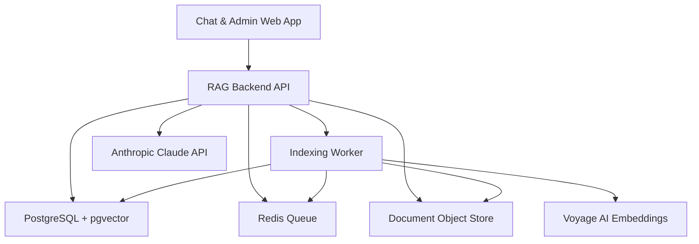
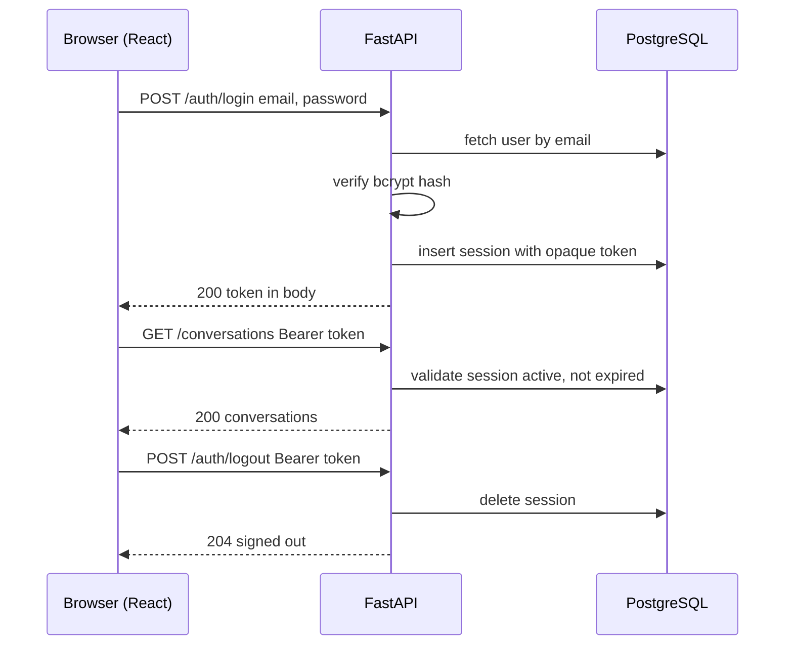
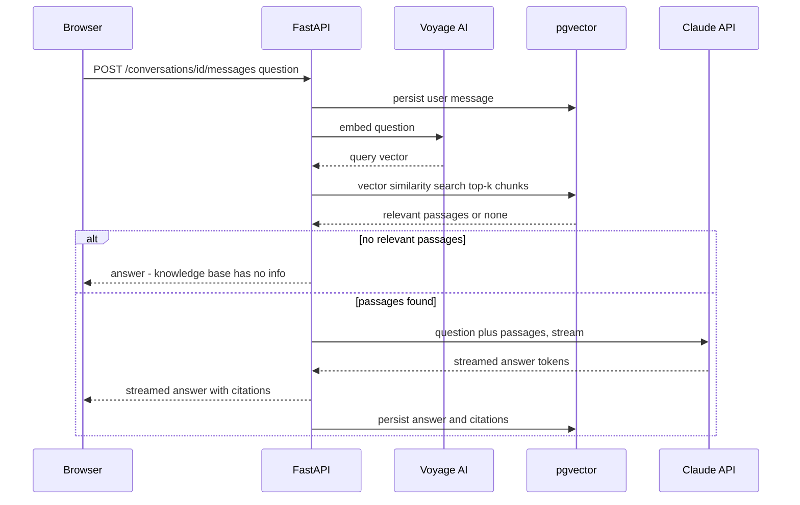
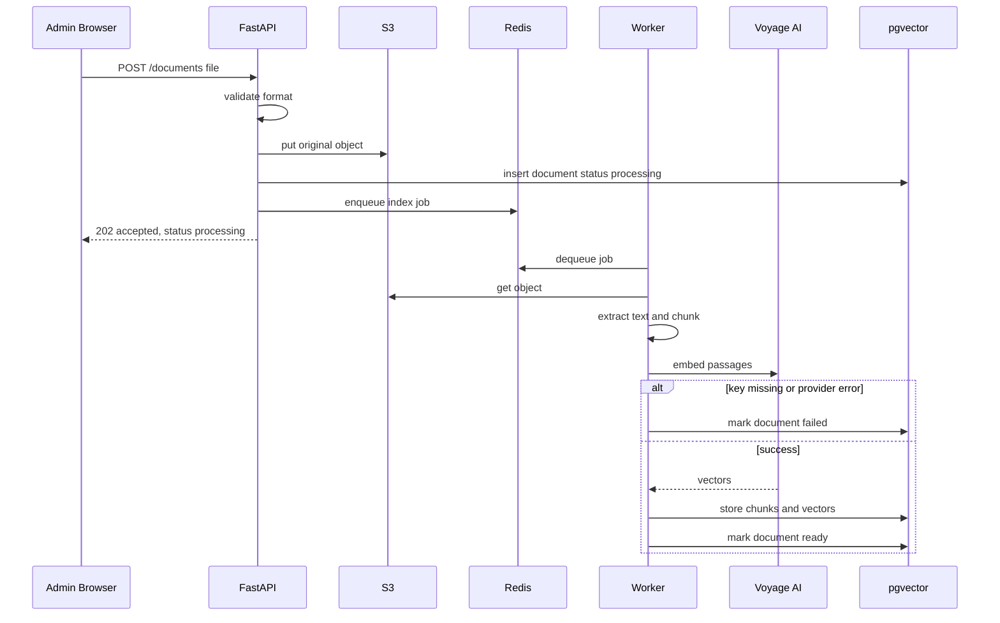
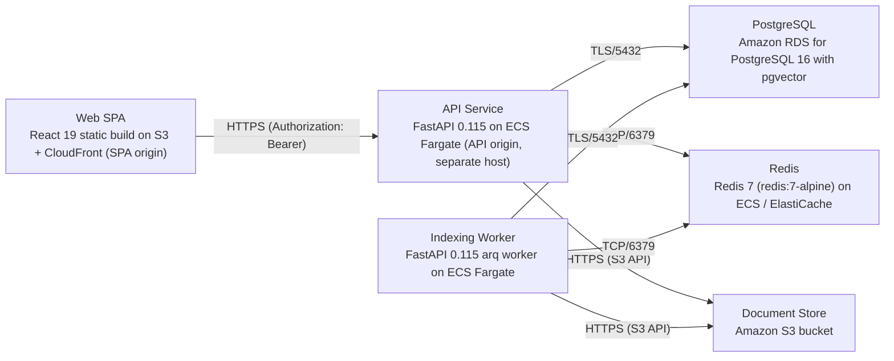

# Architecture

> Maintained by QuorQ AI SDLC. Text between `sdlc:auto` markers is regenerated; anything outside them is yours and is kept.

<!-- sdlc:auto:start narrative -->
## Overview

### ARCH-SUMMARY · approved · source: architecture:summary

Overall shape of the lightweight RAG chatbot architecture for ~50 staff, version 2 approved.

A React 19 responsive web app provides a streaming chat interface and an admin document-management screen; a FastAPI 0.115 backend handles server-side session authentication, orchestrates retrieval-augmented generation (retrieve passages from PostgreSQL 16 + pgvector, call the Anthropic Claude API, return a cited answer), and manages documents. Admin-uploaded PDF, Word, text and Markdown files are stored in Amazon S3, then chunked and embedded via Voyage AI by an async background worker driven by a Redis queue, with vectors stored in pgvector alongside users, roles, conversations and document metadata. SMTP sends password-reset and invite emails. Everything runs in one AWS account/region.

**Related:** REQ-TECH-STACK, REQ-SERVICES

### ARCH-COMP-web · approved · source: architecture:components:web

Chat & Admin Web App component (React 19).

Responsive SPA: sign-in, streaming chat with citations, conversation history, and admin document upload/replace/delete/list. Stores the opaque session token and sends it as Authorization: Bearer on every call.

**Related:** REQ-FEAT-SIGNIN, REQ-FEAT-ASKING, REQ-FEAT-DOCMGMT

### ARCH-COMP-api · approved · source: architecture:components:api

RAG Backend API component (FastAPI 0.115).

Authenticates staff with server-side sessions, enforces the admin role, orchestrates RAG (retrieve, call Claude, stream cited answer), serves conversation history, accepts document uploads to S3, and enqueues indexing jobs.

**Related:** REQ-FEAT-SIGNIN, REQ-FEAT-ASKING, REQ-FEAT-DOCMGMT

### ARCH-COMP-worker · approved · source: architecture:components:worker

Indexing Worker component (arq async worker on FastAPI/Python).

Consumes queued jobs to extract text from uploaded files, chunk passages, embed each via Voyage AI, write vectors to pgvector, and mark documents ready or failed; removes chunks/embeddings on replace and delete.

**Related:** REQ-FEAT-INDEXING

### ARCH-COMP-db · approved · source: architecture:components:db

PostgreSQL + pgvector component, the single datastore.

Single store for users, roles, sessions, conversations/messages, document metadata, chunks and their vector embeddings; provides vector similarity search for retrieval.

**Related:** REQ-TECH-STACK

### ARCH-COMP-queue · approved · source: architecture:components:queue

Redis Queue component (Redis 7).

Background job queue decoupling slow chunk/embed/delete work from admin requests.

**Related:** REQ-FEAT-INDEXING

### ARCH-COMP-storage · approved · source: architecture:components:storage

Document Object Store component (Amazon S3).

Durably stores original uploaded PDF/Word/text/Markdown files for re-processing and for opening the source behind a citation.

**Related:** REQ-FEAT-DOCMGMT

### ARCH-COMP-ai_provider · approved · source: architecture:components:ai_provider

Anthropic Claude API component.

Generates grounded, cited answers from the question plus retrieved passages.

**Related:** REQ-FEAT-ASKING, REQ-FEAT-ANSWERS

### ARCH-COMP-embeddings · approved · source: architecture:components:embeddings

Voyage AI Embeddings component.

Converts document passages (and queries) into vectors for retrieval.

**Related:** REQ-FEAT-INDEXING

### ARCH-PATH-auth · approved · source: architecture:critical-path:auth

Email/password sign-in and session enforcement critical path.

Staff sign in with email and password; backend verifies the bcrypt hash, creates a server-side session row with an opaque token, and returns it in the response body. The SPA stores it and sends Authorization: Bearer on every request. Each protected request validates the token, checks expiry/inactivity and account-active status, and admin routes additionally require the admin role. Sign-out, expiry and account deactivation revoke the session server-side.

**Related:** REQ-FEAT-SIGNIN, REQ-NFR-001, REQ-NFR-002, REQ-NFR-003

### ARCH-PATH-rag · approved · source: architecture:critical-path:rag

RAG question-answering-with-citations critical path.

A signed-in user submits a question in a conversation. The backend embeds the question via Voyage AI, runs a pgvector similarity search over chunks of the shared knowledge base, and if sufficiently relevant passages exist sends them plus the question to Claude, streaming the grounded answer back with citations to the source document and passage. If nothing relevant is found the answer states the knowledge base has no information; if Claude errors the user gets an informative message and the question stays in the thread for retry.

**Related:** REQ-FEAT-ASKING, REQ-FEAT-ANSWERS, REQ-NFR-006

### ARCH-PATH-upload · approved · source: architecture:critical-path:upload

Document upload, chunk and embed (async) critical path.

An admin uploads a supported file. The API validates the format, stores the original in S3, creates a document row with status processing, and enqueues an indexing job on Redis. The worker downloads the file, extracts text (pypdf for PDF, python-docx for Word, plain read for txt/md), splits it into passages, embeds each via Voyage AI, writes chunks and vectors to pgvector, and marks the document ready. A missing Voyage key or provider errors mark the document failed with an informative status, leaving no partial document ready. Replace and delete enqueue jobs that remove the old chunks/embeddings from retrieval.

**Related:** REQ-FEAT-DOCMGMT, REQ-FEAT-INDEXING, REQ-NFR-006

### ARCH-ENTITIES · approved · source: architecture:entities

Data model: the core tables/entities backing the application.

users: id, email, password_hash, role, is_active, created_at. sessions: id, user_id, token_hash, created_at, last_seen_at, expires_at. documents: id, name, format, s3_key, status, status_detail, uploaded_by, created_at, updated_at. document_chunks: id, document_id, chunk_index, content, embedding, created_at. conversations: id, user_id, title, created_at, updated_at. messages: id, conversation_id, role, content, created_at. message_citations: id, message_id, document_id, chunk_id, snippet.

### ARCH-EP-auth · approved · source: architecture:endpoints:auth

Authentication and password-reset endpoints.

POST /auth/login - sign in with email and password; returns an opaque session token in the body; generic invalid-credentials message doesn't reveal which field was wrong. POST /auth/logout - revoke the current session server-side. GET /auth/me - return the signed-in user and role; validates session active, not expired, account active. POST /auth/password-reset/request - send a password-reset email via SMTP if the address matches an account. POST /auth/password-reset/confirm - set a new password from a reset token; stores only the bcrypt hash.

**Related:** REQ-FEAT-SIGNIN, REQ-NFR-003

### ARCH-EP-conversations · approved · source: architecture:endpoints:conversations

Conversation and messaging endpoints.

GET /conversations - list the signed-in user's own conversations (private to the user). POST /conversations - create a new conversation for the signed-in user. GET /conversations/{id}/messages - list messages and citations in the user's own conversation; 404/403 if not theirs. POST /conversations/{id}/messages - ask a question: persist it, retrieve passages, call Claude, stream the grounded cited answer; returns an informative error if Claude is unavailable, leaving the question in the thread.

**Related:** REQ-FEAT-ASKING, REQ-FEAT-HISTORY, REQ-NFR-004

### ARCH-EP-documents · approved · source: architecture:endpoints:documents

Document management endpoints (admin only).

GET /documents - list knowledge-base documents with name, format and status (admin only). POST /documents - upload a PDF/Word/text/Markdown file (admin only); validates format, stores original in S3, enqueues indexing, returns processing status; rejects unsupported formats with the supported list. PUT /documents/{id} - replace an existing document with a new file (admin only); removes old chunks/embeddings and indexes the new version under the same record. DELETE /documents/{id} - delete a document and enqueue removal of all its chunks and embeddings from retrieval (admin only).

**Related:** REQ-FEAT-DOCMGMT, REQ-FEAT-INDEXING

### ARCH-NODE-web · approved · source: architecture:deployment-nodes:web-spa

Web SPA deployment node.

React 19 static build served from S3 + CloudFront (SPA origin); static assets.

**Related:** ARCH-COMP-web

### ARCH-NODE-api · approved · source: architecture:deployment-nodes:api-service

API Service deployment node.

FastAPI 0.115 on ECS Fargate (API origin, separate host from the SPA); Python 3.12 / uvicorn.

**Related:** ARCH-COMP-api

### ARCH-NODE-worker · approved · source: architecture:deployment-nodes:indexing-worker

Indexing Worker deployment node.

FastAPI 0.115 arq worker on ECS Fargate; Python 3.12.

**Related:** ARCH-COMP-worker

### ARCH-NODE-db · approved · source: architecture:deployment-nodes:postgresql

PostgreSQL deployment node.

Amazon RDS for PostgreSQL 16 with the pgvector extension.

**Related:** ARCH-COMP-db

### ARCH-NODE-queue · approved · source: architecture:deployment-nodes:redis

Redis deployment node.

Redis 7 (redis:7-alpine) on ECS / ElastiCache.

**Related:** ARCH-COMP-queue

### ARCH-NODE-storage · approved · source: architecture:deployment-nodes:document-store

Document Store deployment node.

Amazon S3 bucket used as object storage for original uploaded files.

**Related:** ARCH-COMP-storage

### ARCH-TECH-frontend · approved · source: architecture:technology-decisions:frontend

Frontend technology decision: React 19 (alternatives considered: Vue, Svelte).

Delivered as a single responsive SPA for the streaming chat and admin document screens; stores the opaque session token and sends it as Authorization: Bearer, reading the API base URL from VITE_API_BASE_URL since the SPA and API are separate origins.

**Related:** REQ-TECH-STACK

### ARCH-TECH-backend · approved · source: architecture:technology-decisions:backend

Backend technology decision: FastAPI 0.115 (alternatives considered: Flask, Django REST Framework).

Python backend orchestrates RAG and streams Claude responses with server-sent events; strongest ecosystem for the Anthropic and Voyage SDKs. Also runs the arq worker process for async indexing.

**Related:** REQ-TECH-STACK

### ARCH-TECH-database · approved · source: architecture:technology-decisions:database

Database technology decision: PostgreSQL 16 (alternatives considered: MySQL, a dedicated vector database).

One store holds users, roles, sessions, conversations, document metadata and, via the pgvector extension, the embeddings and similarity search -- no second database needed for this modest document volume.

**Related:** REQ-TECH-STACK

### ARCH-TECH-cloud · approved · source: architecture:technology-decisions:cloud

Cloud technology decision: AWS (alternatives considered: Azure, GCP).

Hosts the SPA, API, worker, RDS PostgreSQL, Redis and S3 document storage in one account and region near staff; S3 durably holds the original uploads behind citations.

**Related:** REQ-TECH-STACK
<!-- sdlc:auto:end narrative -->

<!-- sdlc:auto:start building-blocks -->
## Building Block View

| ID | Name | Technology | Responsibility | Depends on |
|---|---|---|---|---|
| web | Chat & Admin Web App | React 19 | Responsive SPA: sign-in, streaming chat with citations, conversation history, and admin document upload/replace/delete/list. Stores the opaque session token and sends it as Authorization: Bearer on every call. | api |
| api | RAG Backend API | FastAPI 0.115 | Authenticates staff with server-side sessions, enforces admin role, orchestrates RAG (retrieve, call Claude, stream cited answer), serves conversation history, accepts document uploads to S3, and enqueues indexing jobs. | db, queue, storage, ai_provider, worker |
| worker | Indexing Worker | FastAPI 0.115 (arq async worker, Python) | Consumes queued jobs to extract text from uploaded files, chunk passages, embed each via Voyage AI, write vectors to pgvector, and mark documents ready or failed; removes chunks/embeddings on replace and delete. | db, queue, storage, embeddings |
| db | PostgreSQL + pgvector | PostgreSQL 16 (pgvector extension) | Single store for users, roles, sessions, conversations/messages, document metadata, chunks and their vector embeddings; vector similarity search for retrieval. | — |
| queue | Redis Queue | Redis 7 (redis:7-alpine) | Background job queue decoupling slow chunk/embed/delete work from admin requests. | — |
| storage | Document Object Store | Amazon S3 | Durably stores original uploaded PDF/Word/text/Markdown files for re-processing and for opening the source behind a citation. | — |
| ai_provider | Anthropic Claude API | Anthropic (Claude) SaaS | Generates grounded, cited answers from the question plus retrieved passages. | — |
| embeddings | Voyage AI Embeddings | Voyage AI SaaS | Converts document passages (and queries) into vectors for retrieval. | — |

<!-- sdlc:auto:end building-blocks -->

<!-- sdlc:auto:start runtime -->
## Runtime View

### Email/password sign-in and session enforcement

Staff sign in with email and password; backend verifies the bcrypt hash, creates a server-side session row with an opaque token, and returns it in the response body. The SPA stores it and sends Authorization: Bearer on every request. Each protected request validates the token, checks expiry/inactivity and account-active status, and admin routes additionally require the admin role. Sign-out, expiry and account deactivation revoke the session server-side.

- **Components:** web, api, db
- **Modules:** auth.routes, auth.sessions, auth.password, auth.deps
- **Key functions:** sign_in(email, password), hash_password(pw), verify_password(pw, hash), create_session(user_id), require_user(token), require_admin(token), revoke_session(token)

### RAG question answering with citations

A signed-in user submits a question in a conversation. The backend embeds the question via Voyage AI, runs a pgvector similarity search over chunks of the shared knowledge base, and if sufficiently relevant passages exist sends them plus the question to Claude, streaming the grounded answer back with citations to the source document and passage. If nothing relevant is found the answer states the knowledge base has no information; if Claude errors the user gets an informative message and the question stays in the thread for retry.

- **Components:** web, api, embeddings, db, ai_provider
- **Modules:** chat.routes, rag.retrieve, rag.generate, rag.citations
- **Key functions:** ask(conversation_id, question), embed_query(text), search_chunks(vector, k), build_prompt(question, passages), stream_answer(prompt), map_citations(passages)

### Document upload, chunk and embed (async)

An admin uploads a supported file. The API validates the format, stores the original in S3, creates a document row with status processing, and enqueues an indexing job on Redis. The worker downloads the file, extracts text (pypdf for PDF, python-docx for Word, plain read for txt/md), splits it into passages, embeds each via Voyage AI, writes chunks and vectors to pgvector, and marks the document ready. Missing Voyage key or provider errors mark the document failed with an informative status and leave no partial document ready. Replace and delete enqueue jobs that remove the old chunks/embeddings from retrieval.

- **Components:** web, api, storage, queue, worker, embeddings, db
- **Modules:** documents.routes, documents.upload, indexing.worker, indexing.extract, indexing.chunk, indexing.embed
- **Key functions:** upload_document(file), validate_format(filename), put_object(bucket, key, bytes), enqueue_index(document_id), extract_text(key, format), chunk_text(text), embed_passages(chunks), store_chunks(document_id, chunks, vectors), delete_document_vectors(document_id)

<!-- sdlc:auto:end runtime -->

<!-- sdlc:auto:start deployment-view -->
## Deployment View

| Name | Service | Runtime | Scaling | Environment |
|---|---|---|---|---|
| Web SPA | React 19 static build on S3 + CloudFront (SPA origin) | Static assets | CDN-cached, single bucket | dev |
| API Service | FastAPI 0.115 on ECS Fargate (API origin, separate host) | Python 3.12 / uvicorn | 1-2 small tasks for ~50 users | dev |
| Indexing Worker | FastAPI 0.115 arq worker on ECS Fargate | Python 3.12 | 1 task | dev |
| PostgreSQL | Amazon RDS for PostgreSQL 16 with pgvector | PostgreSQL 16 | single small instance, encryption at rest enabled | dev |
| Redis | Redis 7 (redis:7-alpine) on ECS / ElastiCache | Redis 7 | single node | dev |
| Document Store | Amazon S3 bucket | Object storage | managed, private bucket, server-side encryption | dev |

| Source | Target | Protocol |
|---|---|---|
| Web SPA | API Service | HTTPS (Authorization: Bearer) |
| API Service | PostgreSQL | TLS/5432 |
| API Service | Redis | TCP/6379 |
| API Service | Document Store | HTTPS (S3 API) |
| Indexing Worker | Redis | TCP/6379 |
| Indexing Worker | PostgreSQL | TLS/5432 |
| Indexing Worker | Document Store | HTTPS (S3 API) |

<!-- sdlc:auto:end deployment-view -->

<!-- sdlc:auto:start decisions -->
## Architecture Decisions

| Layer | Choice | ADR |
|---|---|---|
| Frontend | React 19 | [ADR-0001](adr/frontend.md) |
| Backend | FastAPI 0.115 | [ADR-0002](adr/backend.md) |
| Database | PostgreSQL 16 | [ADR-0003](adr/database.md) |
| Cloud | AWS | [ADR-0004](adr/cloud.md) |
<!-- sdlc:auto:end decisions -->

<!-- sdlc:auto:start links -->
## Related Documents

- [Data Model](data-model.md)
- [API Specification](api/openapi.yaml)
- [Architecture Decision Records](adr/README.md)
<!-- sdlc:auto:end links -->
