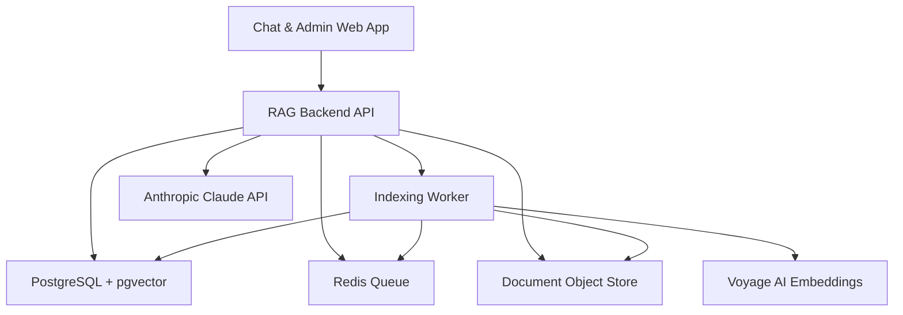
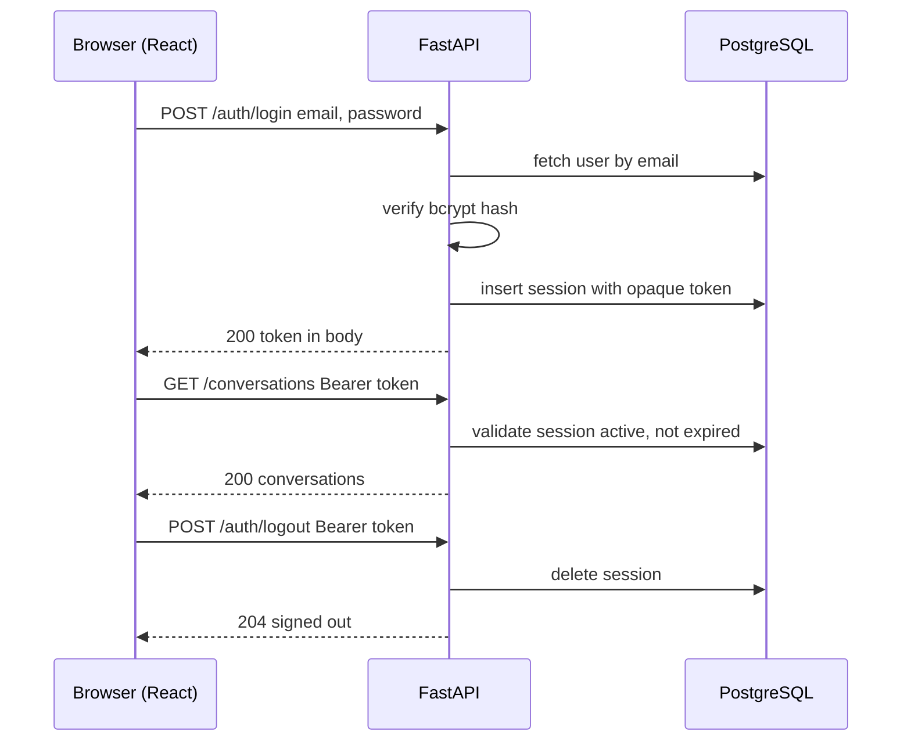
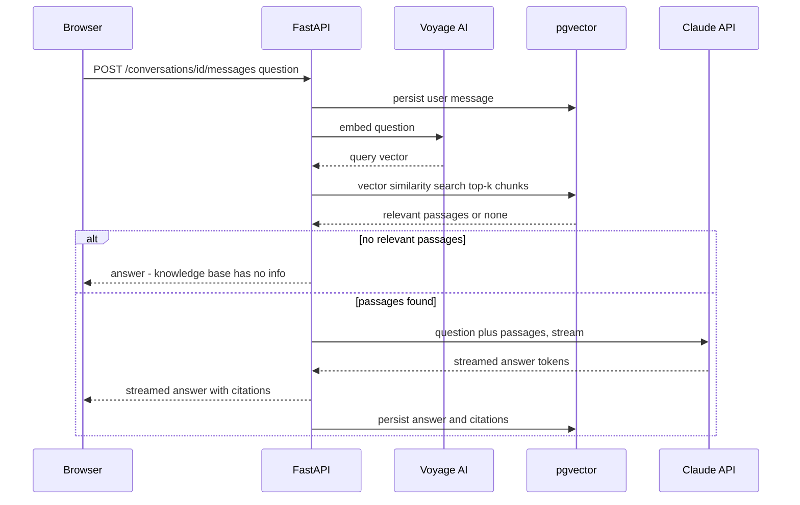
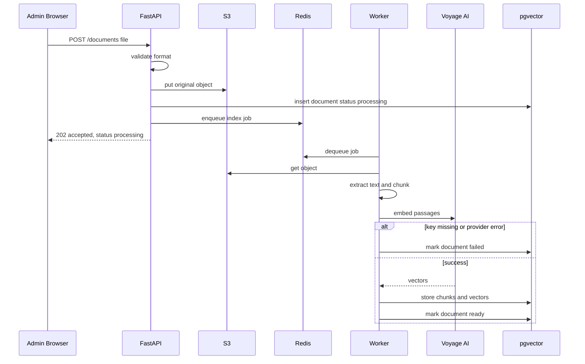
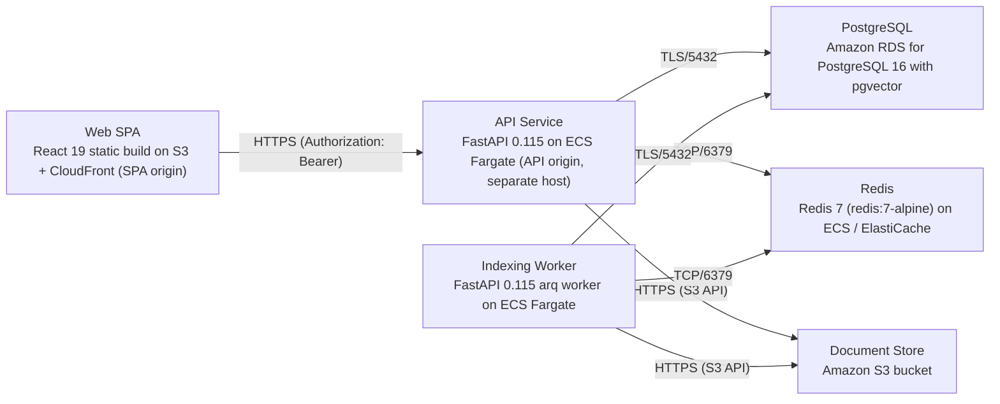

# Architecture

> Maintained by QuorQ AI SDLC. Text between `sdlc:auto` markers is regenerated; anything outside them is yours and is kept.

<!-- sdlc:auto:start narrative -->
## Overview

### ARCH-001 · approved · source: architecture:summary

Overall system design: lightweight internal RAG chatbot for ~50 staff, approved v2.

React 19 responsive SPA provides streaming chat and admin document management; FastAPI 0.115 backend handles server-side session auth, orchestrates RAG (retrieve from PostgreSQL 16 + pgvector, call Anthropic Claude, return cited answer), and manages documents. Admin-uploaded PDF/Word/text/Markdown files are stored in S3, then chunked and embedded via Voyage AI by an async worker driven by a Redis queue; vectors stored in pgvector alongside users, roles, conversations and document metadata. SMTP sends password-reset/invite emails. Everything runs in one AWS account/region.

**Related:** REQ-STACK, REQ-SERVICES

### ARCH-002 · approved · source: architecture:component:web

Chat & Admin Web App (React 19): the SPA covering sign-in, chat, history and admin document management.

Responsive SPA: sign-in, streaming chat with citations, conversation history, and admin document upload/replace/delete/list. Stores the opaque session token and sends it as Authorization: Bearer on every call.

**Related:** REQ-FEAT-SIGNIN, REQ-FEAT-ASKING, REQ-FEAT-DOCMGMT

### ARCH-003 · approved · source: architecture:component:api

RAG Backend API (FastAPI 0.115): authentication, RAG orchestration, document ingestion entry point.

Authenticates staff with server-side sessions, enforces admin role, orchestrates RAG (retrieve, call Claude, stream cited answer), serves conversation history, accepts document uploads to S3, and enqueues indexing jobs.

**Related:** REQ-FEAT-SIGNIN, REQ-FEAT-ASKING, REQ-FEAT-ANSWERS, REQ-FEAT-HISTORY, REQ-FEAT-DOCMGMT

### ARCH-004 · approved · source: architecture:component:worker

Indexing Worker (FastAPI/arq async worker, Python): background document processing.

Consumes queued jobs to extract text from uploaded files, chunk passages, embed each via Voyage AI, write vectors to pgvector, and mark documents ready or failed; removes chunks/embeddings on replace and delete.

**Related:** REQ-FEAT-INDEXING

### ARCH-005 · approved · source: architecture:component:db

PostgreSQL 16 + pgvector: single datastore for the whole application.

Single store for users, roles, sessions, conversations/messages, document metadata, chunks and their vector embeddings; used for vector similarity search at retrieval time.

**Related:** REQ-STACK

### ARCH-006 · approved · source: architecture:component:queue

Redis Queue: decouples slow indexing work from admin requests.

Background job queue (Redis 7, redis:7-alpine) decoupling slow chunk/embed/delete work from admin requests.

**Related:** REQ-SERVICES

### ARCH-007 · approved · source: architecture:component:storage

Document Object Store (Amazon S3): durable storage of original uploaded files.

Durably stores original uploaded PDF/Word/text/Markdown files for re-processing and for opening the source behind a citation.

**Related:** REQ-SERVICES, REQ-FEAT-DOCMGMT

### ARCH-008 · approved · source: architecture:component:ai_provider

Anthropic Claude API: generates the grounded, cited answers.

Generates grounded, cited answers from the question plus retrieved passages.

**Related:** REQ-FEAT-ANSWERS, REQ-SERVICES

### ARCH-009 · approved · source: architecture:component:embeddings

Voyage AI Embeddings: converts passages and queries into vectors.

Converts document passages (and queries) into vectors for retrieval.

**Related:** REQ-FEAT-INDEXING, REQ-SERVICES

### ARCH-010 · approved · source: architecture:critical_path:auth

Email/password sign-in and session enforcement critical path.

Staff sign in with email and password; backend verifies the bcrypt hash, creates a server-side session row with an opaque token, returns it in the response body. The SPA stores it and sends Authorization: Bearer on every request. Each protected request validates the token, checks expiry/inactivity and account-active status; admin routes additionally require the admin role. Sign-out, expiry and account deactivation revoke the session server-side.

**Related:** REQ-FEAT-SIGNIN, NFR-001, NFR-002, NFR-003

### ARCH-011 · approved · source: architecture:critical_path:rag

RAG question-answering with citations critical path.

A signed-in user submits a question; backend embeds the question via Voyage AI, runs a pgvector similarity search over the shared knowledge base's chunks, and if sufficiently relevant passages exist sends them plus the question to Claude, streaming the grounded answer back with citations to document and passage. If nothing relevant is found, the answer states the knowledge base has no information; if Claude errors, the user gets an informative message and the question stays in the thread for retry.

**Related:** REQ-FEAT-ASKING, REQ-FEAT-ANSWERS, NFR-006

### ARCH-012 · approved · source: architecture:critical_path:upload

Document upload, chunk and embed (async) critical path.

An admin uploads a supported file. The API validates the format, stores the original in S3, creates a document row with status processing, and enqueues an indexing job on Redis. The worker downloads the file, extracts text (pypdf for PDF, python-docx for Word, plain read for txt/md), splits it into passages, embeds each via Voyage AI, writes chunks and vectors to pgvector, and marks the document ready. A missing Voyage key or provider errors mark the document failed with an informative status, leaving no partial document ready. Replace and delete enqueue jobs that remove old chunks/embeddings from retrieval.

**Related:** REQ-FEAT-DOCMGMT, REQ-FEAT-INDEXING, NFR-006

### ARCH-013 · approved · source: architecture:entities

Data model: core entities held in PostgreSQL.

users(id, email, password_hash, role, is_active, created_at); sessions(id, user_id, token_hash, created_at, last_seen_at, expires_at); documents(id, name, format, s3_key, status, status_detail, uploaded_by, created_at, updated_at); document_chunks(id, document_id, chunk_index, content, embedding, created_at); conversations(id, user_id, title, created_at, updated_at); messages(id, conversation_id, role, content, created_at); message_citations(id, message_id, document_id, chunk_id, snippet).

### ARCH-014 · approved · source: architecture:endpoints:auth+conversations

Auth and conversation endpoints.

POST /auth/login (sign in, generic invalid-credentials message); POST /auth/logout (revoke session); GET /auth/me (validate session active/not expired/account active); POST /auth/password-reset/request (SMTP email if address matches an account); POST /auth/password-reset/confirm (set new password from reset token, bcrypt hash only); GET /conversations (list own conversations); POST /conversations (create conversation); GET /conversations/{id}/messages (list messages+citations, 404/403 if not owner); POST /conversations/{id}/messages (ask a question: persist, retrieve, call Claude, stream grounded answer; informative error if Claude unavailable, question remains in thread).

**Related:** REQ-FEAT-SIGNIN, REQ-FEAT-ASKING, REQ-FEAT-HISTORY

### ARCH-015 · approved · source: architecture:endpoints:documents

Document management endpoints (admin only).

GET /documents (list name/format/status, admin only); POST /documents (upload PDF/Word/text/Markdown, admin only; validates format, stores in S3, enqueues indexing, returns processing status; rejects unsupported formats with supported list); PUT /documents/{id} (replace, admin only; removes old chunks/embeddings, indexes new version under same record); DELETE /documents/{id} (delete, admin only; enqueues removal of all chunks/embeddings).

**Related:** REQ-FEAT-DOCMGMT

### ARCH-016 · approved · source: architecture:deployment_nodes

Deployment topology: all components hosted on AWS.

Web SPA: React 19 static build on S3 + CloudFront (SPA origin, static assets). API Service: FastAPI 0.115 on ECS Fargate (API origin, separate host, Python 3.12/uvicorn). Indexing Worker: FastAPI 0.115 arq worker on ECS Fargate (Python 3.12). PostgreSQL: Amazon RDS for PostgreSQL 16 with pgvector. Redis: Redis 7 (redis:7-alpine) on ECS / ElastiCache. Document Store: Amazon S3 bucket (object storage).

**Related:** REQ-STACK

### ARCH-017 · approved · source: architecture:technology_decisions

Rationale and alternatives considered for each core technology choice.

Frontend: React 19 (alternatives: Vue, Svelte) -- single responsive SPA for streaming chat + admin screens, stores opaque session token as Authorization: Bearer, reads API base URL from VITE_API_BASE_URL (separate origins). Backend: FastAPI 0.115 (alternatives: Flask, Django REST Framework) -- orchestrates RAG, streams Claude responses via server-sent events, strongest ecosystem for Anthropic/Voyage SDKs; also runs the arq worker process. Database: PostgreSQL 16 (alternatives: MySQL, dedicated vector database) -- single store for users/roles/sessions/conversations/doc metadata and, via pgvector, embeddings/similarity search. Cloud: AWS (alternatives: Azure, GCP) -- hosts SPA, API, worker, RDS PostgreSQL, Redis and S3 in one account/region near staff.

**Related:** REQ-STACK
<!-- sdlc:auto:end narrative -->

<!-- sdlc:auto:start building-blocks -->
## Building Block View

| ID | Name | Technology | Responsibility | Depends on |
|---|---|---|---|---|
| web | Chat & Admin Web App | React 19 | Responsive SPA: sign-in, streaming chat with citations, conversation history, and admin document upload/replace/delete/list. Stores the opaque session token and sends it as Authorization: Bearer on every call. | api |
| api | RAG Backend API | FastAPI 0.115 | Authenticates staff with server-side sessions, enforces admin role, orchestrates RAG (retrieve, call Claude, stream cited answer), serves conversation history, accepts document uploads to S3, and enqueues indexing jobs. | db, queue, storage, ai_provider, worker |
| worker | Indexing Worker | FastAPI 0.115 (arq async worker, Python) | Consumes queued jobs to extract text from uploaded files, chunk passages, embed each via Voyage AI, write vectors to pgvector, and mark documents ready or failed; removes chunks/embeddings on replace and delete. | db, queue, storage, embeddings |
| db | PostgreSQL + pgvector | PostgreSQL 16 (pgvector extension) | Single store for users, roles, sessions, conversations/messages, document metadata, chunks and their vector embeddings; vector similarity search for retrieval. | — |
| queue | Redis Queue | Redis 7 (redis:7-alpine) | Background job queue decoupling slow chunk/embed/delete work from admin requests. | — |
| storage | Document Object Store | Amazon S3 | Durably stores original uploaded PDF/Word/text/Markdown files for re-processing and for opening the source behind a citation. | — |
| ai_provider | Anthropic Claude API | Anthropic (Claude) SaaS | Generates grounded, cited answers from the question plus retrieved passages. | — |
| embeddings | Voyage AI Embeddings | Voyage AI SaaS | Converts document passages (and queries) into vectors for retrieval. | — |

<!-- sdlc:auto:end building-blocks -->

<!-- sdlc:auto:start runtime -->
## Runtime View

### Email/password sign-in and session enforcement

Staff sign in with email and password; backend verifies the bcrypt hash, creates a server-side session row with an opaque token, and returns it in the response body. The SPA stores it and sends Authorization: Bearer on every request. Each protected request validates the token, checks expiry/inactivity and account-active status, and admin routes additionally require the admin role. Sign-out, expiry and account deactivation revoke the session server-side.

- **Components:** web, api, db
- **Modules:** auth.routes, auth.sessions, auth.password, auth.deps
- **Key functions:** sign_in(email, password), hash_password(pw), verify_password(pw, hash), create_session(user_id), require_user(token), require_admin(token), revoke_session(token)

### RAG question answering with citations

A signed-in user submits a question in a conversation. The backend embeds the question via Voyage AI, runs a pgvector similarity search over chunks of the shared knowledge base, and if sufficiently relevant passages exist sends them plus the question to Claude, streaming the grounded answer back with citations to the source document and passage. If nothing relevant is found the answer states the knowledge base has no information; if Claude errors the user gets an informative message and the question stays in the thread for retry.

- **Components:** web, api, embeddings, db, ai_provider
- **Modules:** chat.routes, rag.retrieve, rag.generate, rag.citations
- **Key functions:** ask(conversation_id, question), embed_query(text), search_chunks(vector, k), build_prompt(question, passages), stream_answer(prompt), map_citations(passages)

### Document upload, chunk and embed (async)

An admin uploads a supported file. The API validates the format, stores the original in S3, creates a document row with status processing, and enqueues an indexing job on Redis. The worker downloads the file, extracts text (pypdf for PDF, python-docx for Word, plain read for txt/md), splits it into passages, embeds each via Voyage AI, writes chunks and vectors to pgvector, and marks the document ready. Missing Voyage key or provider errors mark the document failed with an informative status and leave no partial document ready. Replace and delete enqueue jobs that remove the old chunks/embeddings from retrieval.

- **Components:** web, api, storage, queue, worker, embeddings, db
- **Modules:** documents.routes, documents.upload, indexing.worker, indexing.extract, indexing.chunk, indexing.embed
- **Key functions:** upload_document(file), validate_format(filename), put_object(bucket, key, bytes), enqueue_index(document_id), extract_text(key, format), chunk_text(text), embed_passages(chunks), store_chunks(document_id, chunks, vectors), delete_document_vectors(document_id)

<!-- sdlc:auto:end runtime -->

<!-- sdlc:auto:start deployment-view -->
## Deployment View

| Name | Service | Runtime | Scaling | Environment |
|---|---|---|---|---|
| Web SPA | React 19 static build on S3 + CloudFront (SPA origin) | Static assets | CDN-cached, single bucket | dev |
| API Service | FastAPI 0.115 on ECS Fargate (API origin, separate host) | Python 3.12 / uvicorn | 1-2 small tasks for ~50 users | dev |
| Indexing Worker | FastAPI 0.115 arq worker on ECS Fargate | Python 3.12 | 1 task | dev |
| PostgreSQL | Amazon RDS for PostgreSQL 16 with pgvector | PostgreSQL 16 | single small instance, encryption at rest enabled | dev |
| Redis | Redis 7 (redis:7-alpine) on ECS / ElastiCache | Redis 7 | single node | dev |
| Document Store | Amazon S3 bucket | Object storage | managed, private bucket, server-side encryption | dev |

| Source | Target | Protocol |
|---|---|---|
| Web SPA | API Service | HTTPS (Authorization: Bearer) |
| API Service | PostgreSQL | TLS/5432 |
| API Service | Redis | TCP/6379 |
| API Service | Document Store | HTTPS (S3 API) |
| Indexing Worker | Redis | TCP/6379 |
| Indexing Worker | PostgreSQL | TLS/5432 |
| Indexing Worker | Document Store | HTTPS (S3 API) |

<!-- sdlc:auto:end deployment-view -->

<!-- sdlc:auto:start decisions -->
## Architecture Decisions

| Layer | Choice | ADR |
|---|---|---|
| Frontend | React 19 | [ADR-0001](adr/frontend.md) |
| Backend | FastAPI 0.115 | [ADR-0002](adr/backend.md) |
| Database | PostgreSQL 16 | [ADR-0003](adr/database.md) |
| Cloud | AWS | [ADR-0004](adr/cloud.md) |
<!-- sdlc:auto:end decisions -->

<!-- sdlc:auto:start links -->
## Related Documents

- [Data Model](data-model.md)
- [API Specification](api/openapi.yaml)
- [Architecture Decision Records](adr/README.md)
<!-- sdlc:auto:end links -->
