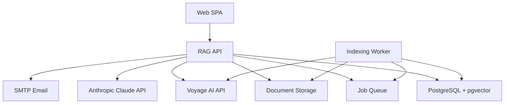
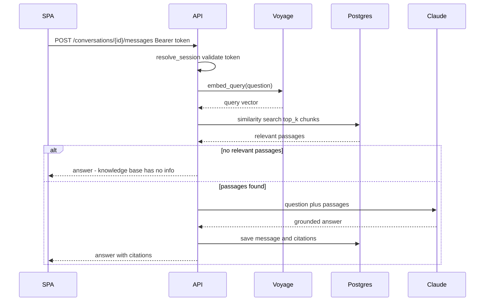
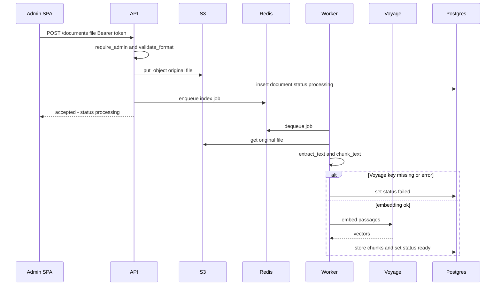
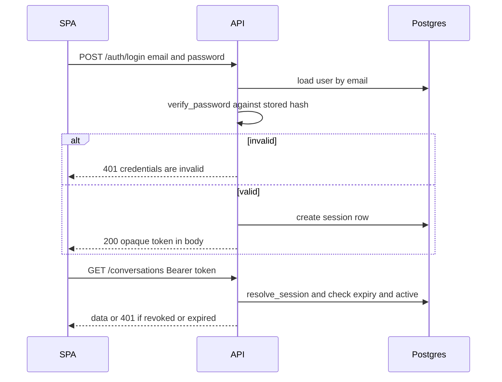
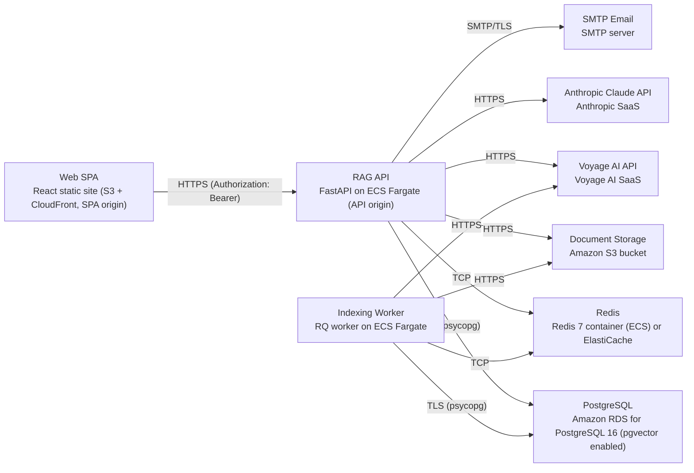

# Architecture

> Maintained by QuorQ AI SDLC. Text between `sdlc:auto` markers is regenerated; anything outside them is yours and is kept.

<!-- sdlc:auto:start narrative -->
## Overview

### ARCH-001 · approved · source: architecture:summary

Blogger is a lightweight internal RAG chatbot for ~50 staff built on the approved stack (React 19 SPA, FastAPI 0.115, PostgreSQL 16 + pgvector, AWS/S3).

Signed-in staff ask questions in a chat interface; the backend embeds the question with Voyage AI, retrieves relevant passages from pgvector, sends them with the question to Claude, and streams back a grounded, cited answer. Admins upload PDF/Word/text/Markdown to a single shared knowledge base; a Redis-backed background worker extracts text, chunks, embeds via Voyage AI, and stores vectors, marking documents ready/failed/processing. Conversation history is saved per user and private. Authentication is email/password with server-side opaque-token sessions returned in the login body and sent as Authorization: Bearer; an admin role gates document management.

**Related:** REQ-STACK, REQ-SERVICES

### ARCH-002 · approved · source: architecture:components

Nine system components: frontend SPA, API, indexing worker, database, queue, document storage, and three external SaaS integrations.

- frontend: React 19 SPA — chat UI, sign-in, conversation history list, admin document UI; stores session token, sends Authorization: Bearer.
- api: FastAPI 0.115 — auth/sessions, role checks, chat orchestration (embed/retrieve/call Claude/stream), document upload/replace/delete, enqueues indexing jobs, serves history.
- worker: Python RQ worker (FastAPI 0.115 codebase) — extracts text, chunks, embeds via Voyage AI, stores chunks/embeddings in pgvector, updates status, removes chunks on delete/replace.
- database: PostgreSQL 16 + pgvector — users, roles, sessions, document metadata, conversations, messages, chunks + embeddings.
- redis: Redis 7 job queue — holds indexing/deletion jobs so admins aren't blocked.
- s3: Amazon S3 — durable storage of original uploaded files.
- ai_provider: Anthropic Claude API — generates grounded, cited answers.
- embeddings: Voyage AI API — embeds questions and passages.
- email: SMTP server — password-reset and account-invite messages.

### ARCH-003 · approved · source: architecture:critical_path:ask-question

Critical path: a signed-in user asks a question and receives a cited, grounded answer.

The API validates the Bearer token, embeds the question with Voyage AI, runs a pgvector similarity search over shared chunks, and — if relevant passages are found — sends them with the question to Claude; the answer is saved to the conversation with citations and returned. If no passage is relevant, the system answers that the knowledge base has no information. If Claude errors, an informative message is returned and the question stays in the thread.

**Related:** REQ-FEAT-CHAT, REQ-FEAT-ANSWERS

### ARCH-004 · approved · source: architecture:critical_path:upload-and-index

Critical path: an admin uploads a document and it becomes retrievable (or fails cleanly).

The API validates role and format, stores the original in S3, creates a document row with status processing, and enqueues an indexing job. The worker extracts text, chunks it, embeds each chunk via Voyage AI, stores chunks with embeddings, and marks the document ready. If the Voyage key is missing or embedding errors, the document is marked failed and no partial content is treated as ready.

**Related:** REQ-FEAT-DOCMGMT, REQ-FEAT-INDEX

### ARCH-005 · approved · source: architecture:critical_path:sign-in-access-control

Critical path: sign-in, session issuance, and server-side session revocation.

A user signs in with email and password. The API verifies the password against its stored hash, creates a server-side session, and returns an opaque token in the body. Protected endpoints resolve the token on each request; sign-out, inactivity expiry, or admin deactivation revoke the session server-side so further requests are rejected.

**Related:** REQ-FEAT-AUTH, NFR-001, NFR-002, NFR-003

### ARCH-006 · approved · source: architecture:entities

Seven core data entities underpin auth, documents, and conversations.

- users: id, email, password_hash, role, is_active, created_at
- sessions: id, user_id, token_hash, expires_at, last_active_at, revoked_at, created_at
- documents: id, name, format, s3_key, status, status_detail, uploaded_by, created_at, updated_at
- document_chunks: id, document_id, chunk_index, content, embedding, created_at
- conversations: id, user_id, title, created_at, updated_at
- messages: id, conversation_id, role, content, created_at
- message_citations: id, message_id, document_id, chunk_id, snippet

### ARCH-007 · approved · source: architecture:endpoints

Eleven REST endpoints cover auth, conversations, and document management.

- POST /auth/login — sign in, returns opaque token; 401 generic message on invalid credentials.
- POST /auth/logout — revokes current session.
- GET /auth/me — returns signed-in user/role; 401 if expired/revoked/deactivated.
- POST /auth/password-reset/request — sends password-reset email via SMTP.
- GET /conversations — lists the signed-in user's own conversations only.
- POST /conversations — creates a new conversation for the signed-in user.
- GET /conversations/{id}/messages — returns messages/citations for an own conversation; 403 if another user's.
- POST /conversations/{id}/messages — embeds question, retrieves passages, calls Claude, returns grounded answer with citations; handles no-relevant-passage and Claude-error cases.
- GET /documents — lists documents with name/format/status (admin only).
- POST /documents — uploads PDF/.docx/.txt/.md, stores in S3, enqueues indexing; rejects unsupported formats (admin only).
- PUT /documents/{id} — replaces a document, removes old chunks, reindexes (admin only).
- DELETE /documents/{id} — deletes a document and all its chunks/embeddings (admin only).

### ARCH-008 · approved · source: architecture:deployment_nodes

AWS-hosted deployment topology: static SPA, two Fargate services, managed Postgres, Redis, S3, and three external SaaS APIs.

- Web SPA: React static site on S3 + CloudFront.
- RAG API: FastAPI on ECS Fargate, Python 3.12 / Uvicorn.
- Indexing Worker: RQ worker on ECS Fargate, Python 3.12.
- PostgreSQL: Amazon RDS for PostgreSQL 16 (pgvector enabled).
- Redis: Redis 7 container on ECS or ElastiCache.
- Document Storage: Amazon S3 bucket.
- External: Anthropic Claude API, Voyage AI API, SMTP server.

### ARCH-009 · approved · source: architecture:technology_decisions

Rationale for each approved stack choice over its considered alternatives.

- Frontend: React 19 (vs Vue, Svelte) — responsive SPA for streaming chat, history, admin screens; reads VITE_API_BASE_URL; stores opaque token for Bearer calls.
- Backend: FastAPI 0.115 (vs Django, Flask) — first-class Anthropic/Voyage libraries, streaming responses suit chat; orchestrates embed-retrieve-generate and enqueues indexing.
- Database: PostgreSQL 16 (vs MySQL, dedicated vector DB) — one store for users/sessions/metadata/conversations plus pgvector embeddings, no separate vector service needed at this volume.
- Cloud: AWS (vs GCP, Azure) — hosts SPA, API, worker, RDS, Redis, S3 in one account, region near staff.

**Related:** REQ-STACK
<!-- sdlc:auto:end narrative -->

<!-- sdlc:auto:start building-blocks -->
## Building Block View

| ID | Name | Technology | Responsibility | Depends on |
|---|---|---|---|---|
| frontend | Web SPA | React 19 | Responsive chat interface, sign-in screen, conversation history list, and admin document management UI. Stores the opaque session token and sends it as Authorization: Bearer on every API call. | api |
| api | RAG API | FastAPI 0.115 | FastAPI service: authentication and sessions, role checks, chat orchestration (embed question, retrieve passages, call Claude, stream cited answer), document upload/replace/delete, enqueues indexing jobs, and serves conversation history. | database, redis, s3, ai_provider, embeddings, email |
| worker | Indexing Worker | Python (RQ) on FastAPI 0.115 codebase | Background worker consuming the Redis queue: extracts text from uploaded files, splits into passages, embeds each via Voyage AI, stores chunks and embeddings in pgvector, and updates document status (processing/ready/failed). Removes chunks on delete/replace. | database, redis, s3, embeddings |
| database | PostgreSQL + pgvector | PostgreSQL 16 (pgvector) | Single store for users, roles, sessions, document metadata, conversations, messages, and document chunks with their vector embeddings for similarity search. | — |
| redis | Job Queue | Redis 7 | Holds background indexing and deletion jobs so admins are not blocked while documents are chunked and embedded. | — |
| s3 | Document Storage | Amazon S3 | Durably stores the original uploaded PDF, Word, text and Markdown files so they can be re-processed or opened behind a citation. | — |
| ai_provider | Anthropic Claude API | Anthropic (Claude) SaaS | Generates grounded, cited answers from the question and retrieved passages. | — |
| embeddings | Voyage AI API | Voyage AI SaaS | Turns question and document passages into vector embeddings for retrieval. | — |
| email | SMTP Email | SMTP server | Sends password-reset and account-invite messages for email/password accounts. | — |

<!-- sdlc:auto:end building-blocks -->

<!-- sdlc:auto:start runtime -->
## Runtime View

### Ask a question and get a cited answer

A signed-in user submits a question. The API validates the Bearer token, embeds the question with Voyage AI, runs a pgvector similarity search over shared chunks, and if relevant passages are found sends them with the question to Claude; the answer is saved to the conversation with citations and returned. If no passage is relevant, the system answers that the knowledge base has no information. If Claude errors, an informative message is returned and the question stays in the thread.

- **Components:** frontend, api, database, embeddings, ai_provider
- **Modules:** auth.session, chat.service, retrieval.service, llm.claude_client, embeddings.voyage_client
- **Key functions:** resolve_session(token), embed_query(text), search_chunks(query_vector, top_k), build_grounded_prompt(question, passages), generate_answer(prompt), save_message(conversation_id, role, content, citations)

### Upload and index a document

An admin uploads a supported file. The API validates role and format, stores the original in S3, creates a document row with status processing, and enqueues an indexing job. The worker extracts text, chunks it, embeds each chunk via Voyage AI, stores chunks with embeddings, and marks the document ready. If the Voyage key is missing or embedding errors, the document is marked failed and no partial content is treated as ready.

- **Components:** frontend, api, s3, redis, worker, embeddings, database
- **Modules:** documents.service, storage.s3_client, queue.enqueue, indexing.worker, extract.text, embeddings.voyage_client
- **Key functions:** require_admin(session), validate_format(filename), put_object(bucket, key, bytes), enqueue_index(document_id), extract_text(file), chunk_text(text), embed_passages(chunks), store_chunks(document_id, chunks, vectors), set_status(document_id, status)

### Sign in and access control

A user signs in with email and password. The API verifies the password against its stored hash, creates a server-side session, and returns an opaque token in the body. Protected endpoints resolve the token on each request; sign-out, inactivity expiry, or admin deactivation revoke the session server-side so further requests are rejected.

- **Components:** frontend, api, database
- **Modules:** auth.service, auth.session, security.hashing
- **Key functions:** verify_password(password, hash), create_session(user_id), resolve_session(token), revoke_session(token), require_admin(session)

<!-- sdlc:auto:end runtime -->

<!-- sdlc:auto:start deployment-view -->
## Deployment View

| Name | Service | Runtime | Scaling | Environment |
|---|---|---|---|---|
| Web SPA | React static site (S3 + CloudFront, SPA origin) | Static assets | CDN-served, no app scaling | dev |
| RAG API | FastAPI on ECS Fargate (API origin) | Python 3.12 / Uvicorn | 1-2 tasks, sized for ~50 users | dev |
| Indexing Worker | RQ worker on ECS Fargate | Python 3.12 | 1 task | dev |
| PostgreSQL | Amazon RDS for PostgreSQL 16 (pgvector enabled) | PostgreSQL 16 | Single instance | dev |
| Redis | Redis 7 container (ECS) or ElastiCache | redis:7-alpine | Single node | dev |
| Document Storage | Amazon S3 bucket | S3 | Managed | dev |
| Anthropic Claude API | Anthropic SaaS | External | Managed by vendor | dev |
| Voyage AI API | Voyage AI SaaS | External | Managed by vendor | dev |
| SMTP Email | SMTP server | External | Managed | dev |

| Source | Target | Protocol |
|---|---|---|
| Web SPA | RAG API | HTTPS (Authorization: Bearer) |
| RAG API | PostgreSQL | TLS (psycopg) |
| RAG API | Redis | TCP |
| RAG API | Document Storage | HTTPS |
| RAG API | Anthropic Claude API | HTTPS |
| RAG API | Voyage AI API | HTTPS |
| RAG API | SMTP Email | SMTP/TLS |
| Indexing Worker | Redis | TCP |
| Indexing Worker | PostgreSQL | TLS (psycopg) |
| Indexing Worker | Document Storage | HTTPS |
| Indexing Worker | Voyage AI API | HTTPS |

<!-- sdlc:auto:end deployment-view -->

<!-- sdlc:auto:start decisions -->
## Architecture Decisions

| Layer | Choice | ADR |
|---|---|---|
| Frontend | React 19 | [ADR-0001](adr/frontend.md) |
| Backend | FastAPI 0.115 | [ADR-0002](adr/backend.md) |
| Database | PostgreSQL 16 | [ADR-0003](adr/database.md) |
| Cloud | AWS | [ADR-0004](adr/cloud.md) |
<!-- sdlc:auto:end decisions -->

<!-- sdlc:auto:start links -->
## Related Documents

- [Data Model](data-model.md)
- [API Specification](api/openapi.yaml)
- [Architecture Decision Records](adr/README.md)
<!-- sdlc:auto:end links -->
