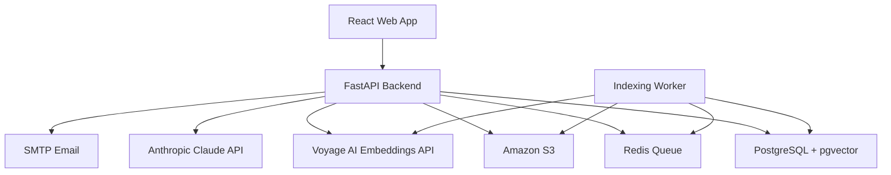
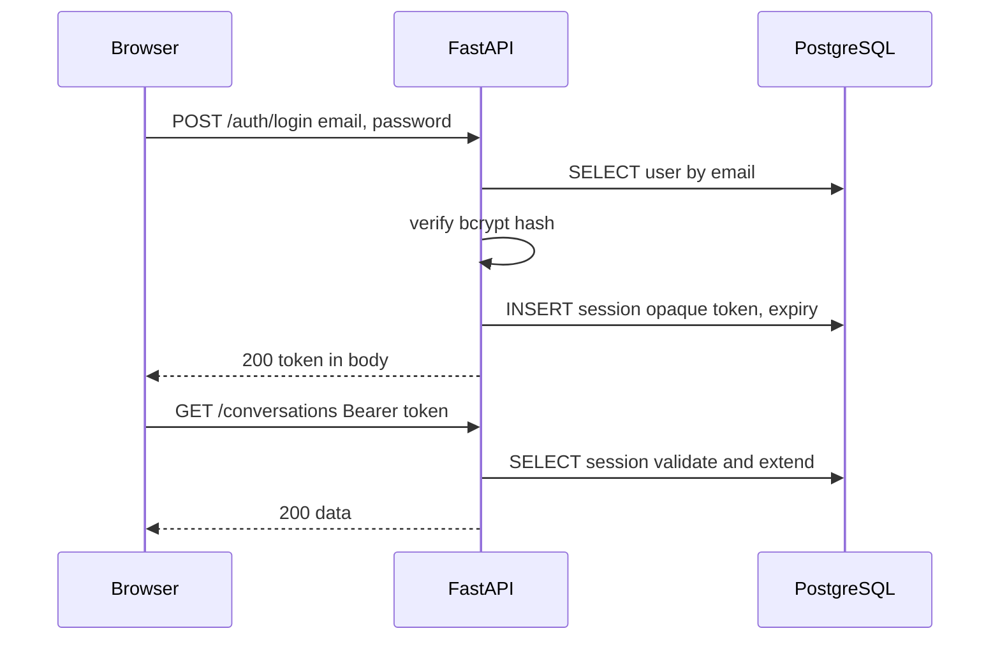
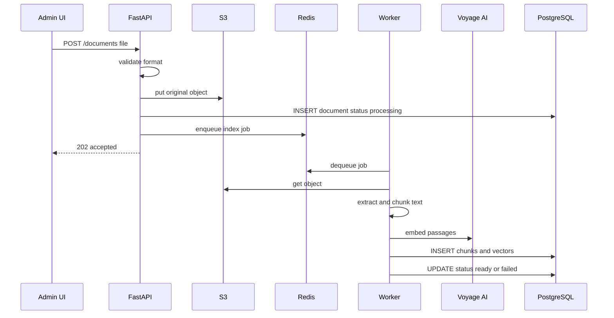
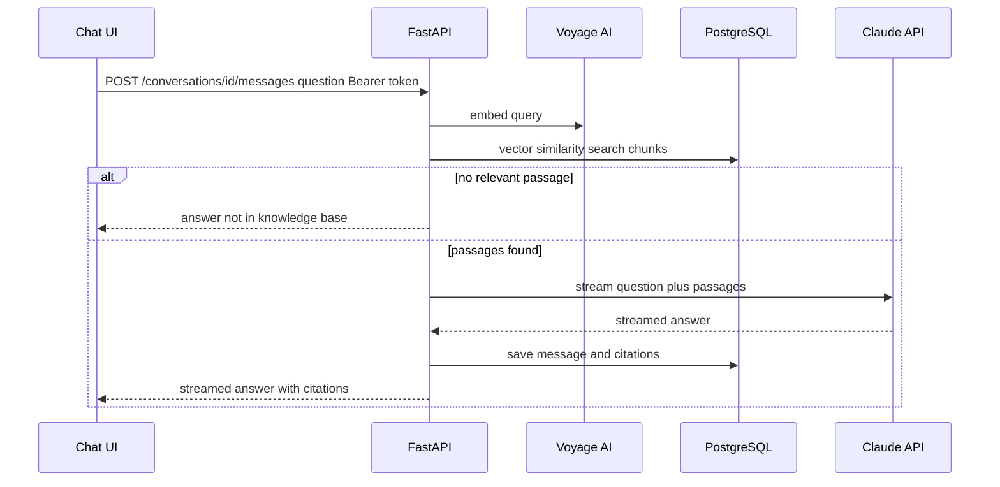
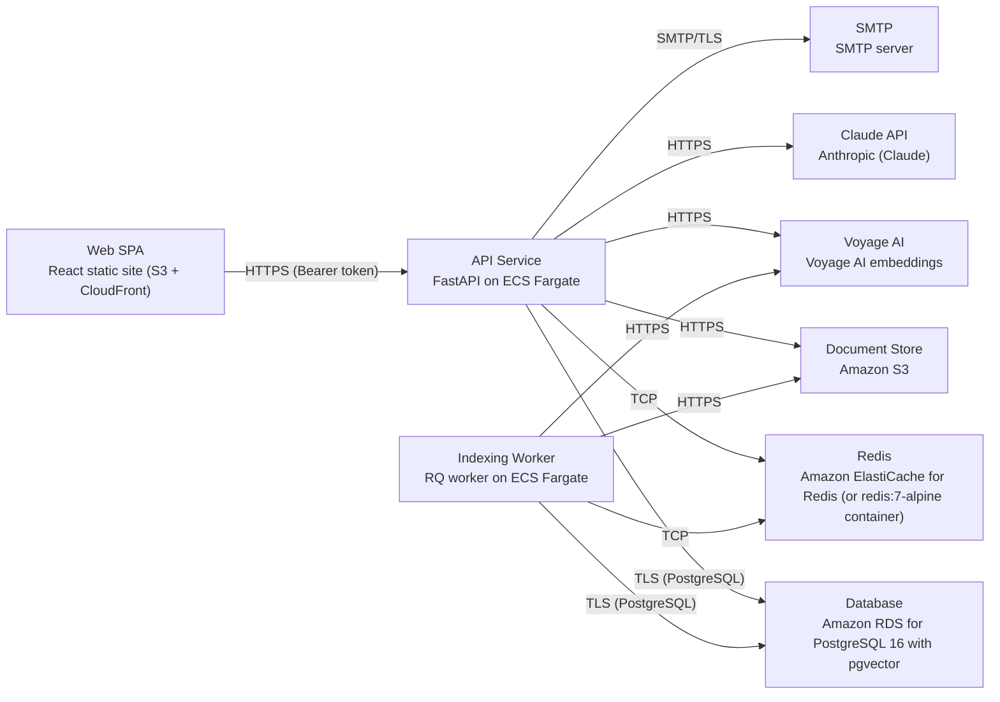

# Architecture

> Maintained by QuorQ AI SDLC. Text between `sdlc:auto` markers is regenerated; anything outside them is yours and is kept.

<!-- sdlc:auto:start narrative -->
## Overview

### ARCH-OVERVIEW · approved · source: architecture:summary

Blogger is a lightweight internal RAG chatbot for ~50 staff: a React 19 SPA, a FastAPI 0.115 API, and a single PostgreSQL 16 + pgvector database holding users, sessions, conversations, documents and chunk embeddings.

Admins upload PDF/Word/text/Markdown files; originals go to S3 and a Redis-backed worker extracts, chunks and embeds text with Voyage AI into pgvector. Staff sign in with email/password (opaque bearer-token sessions) and ask questions in a streaming chat; the API does vector similarity retrieval, sends matched passages with the question to the Anthropic Claude API, and returns a grounded, cited answer saved privately to that user's history. SMTP sends invite and password-reset mail. Everything runs in one AWS account in a region near staff; no data-residency regime is stated. Architecture status: approved, version 1.

### COMP-WEB · approved · source: architecture:components:web

React 19 responsive SPA covering sign-in, streaming chat with citations, per-user conversation history, and the admin document-management screen.

Redirects unauthenticated users to sign-in. Sends Authorization: Bearer <token> on every API call. Built with Vite, reads the API base URL from VITE_API_BASE_URL.

**Related:** FLOW-AUTH, FLOW-RAG

### COMP-API · approved · source: architecture:components:api

FastAPI 0.115 backend orchestrating auth, session validation, RAG retrieval and streaming Claude answer generation, document CRUD, citation assembly, and enqueuing indexing jobs.

Enforces role checks (admin vs staff) and per-user history isolation so users cannot access other users' conversations.

**Related:** COMP-DB, COMP-QUEUE, COMP-WEB, FLOW-AUTH, FLOW-UPLOAD, FLOW-RAG

### COMP-WORKER · approved · source: architecture:components:worker

Python RQ worker that consumes the Redis queue, fetches uploaded files from S3, extracts and chunks text, embeds passages via Voyage AI, and stores chunks/vectors in PostgreSQL.

Updates document status to processing/ready/failed. Handles document replace and delete by purging old chunks before re-indexing or removal.

**Related:** COMP-QUEUE, COMP-S3, COMP-VOYAGE, COMP-DB, FLOW-UPLOAD

### COMP-DB · approved · source: architecture:components:db

Single PostgreSQL 16 database with the pgvector extension storing users, roles, sessions, document metadata, chunk embeddings, conversations and messages with citations.

Also performs vector similarity search for RAG retrieval, avoiding the need for a separate vector database at this volume.

**Related:** DATA-MODEL

### COMP-QUEUE · approved · source: architecture:components:queue

Redis 7 queue holding background jobs for chunking, embedding and deletion so admins are not blocked while a document is processed.

Jobs are consumed by the Indexing Worker; deployed via Amazon ElastiCache for Redis or a redis:7-alpine container.

**Related:** COMP-WORKER, FLOW-UPLOAD

### COMP-S3 · approved · source: architecture:components:filestore

Amazon S3 durably stores original uploaded PDF, Word, text and Markdown files.

Used for re-processing (replace/re-index) and for opening the source document behind a citation via a short-lived link.

**Related:** COMP-WORKER, FLOW-UPLOAD

### COMP-CLAUDE · approved · source: architecture:components:ai

Anthropic Claude API generates grounded, cited answers from the user's question plus retrieved passages.

Invoked by the API's RAG flow with streaming; returns an informative error (question retained in thread) if the Claude call fails.

**Related:** FLOW-RAG

### COMP-VOYAGE · approved · source: architecture:components:embed

Voyage AI Embeddings API converts document passages and user queries into vectors for similarity retrieval.

Used both at indexing time (embedding each passage) and at query time (embedding the question). Missing key or provider errors cause the document to be marked failed with an informative status, never left partially indexed as ready.

**Related:** FLOW-UPLOAD, FLOW-RAG

### COMP-SMTP · approved · source: architecture:components:email

SMTP server sends account-invite and password-reset email messages to staff.

Invoked from the password-reset request flow and account invitation (per summary); specific trigger endpoints: POST /auth/password-reset/request.

### FLOW-AUTH · approved · source: architecture:critical_paths:Email/password sign-in with opaque session token

Staff sign in with email and password; the API verifies a bcrypt hash and issues an opaque, server-side session token.

Step 1: Staff submit email and password. Step 2: API verifies the bcrypt password hash without revealing which field was wrong on failure. Step 3: API creates a server-side session row with an opaque token and an inactivity expiry, returned in the response body. Step 4: SPA stores the token and sends it as an Authorization: Bearer header on every call. Step 5: Sign-out, expiry, or account deactivation revoke or invalidate the session server-side.

**Related:** COMP-API, COMP-WEB, COMP-DB

### FLOW-UPLOAD · approved · source: architecture:critical_paths:Document upload, chunk and embed

Admin uploads a supported document; it is stored in S3 and asynchronously chunked, embedded and indexed by the worker.

Step 1: Admin uploads a PDF, .docx, .txt or .md file. Step 2: API validates the format and stores the original in S3. Step 3: API creates a document row with status processing and enqueues an indexing job. Step 4: Worker extracts text, splits it into passages, and embeds each passage with Voyage AI. Step 5: Worker stores chunks and vectors in PostgreSQL and marks the document ready. Step 6: If the Voyage key is missing or the provider errors, the worker marks the document failed with an informative status detail -- a partial document is never left marked ready.

**Related:** COMP-API, COMP-WORKER, COMP-S3, COMP-QUEUE, COMP-VOYAGE, COMP-DB

### FLOW-RAG · approved · source: architecture:critical_paths:RAG question to grounded cited answer

A signed-in user asks a question; the API retrieves relevant passages by vector similarity and returns a grounded, cited, streamed Claude answer saved to the user's private history.

Step 1: Signed-in user asks a question in chat. Step 2: API embeds the query with Voyage AI. Step 3: API runs a pgvector similarity search over the shared knowledge base. Step 4: If sufficiently relevant passages exist, API sends them with the question to Claude and streams the answer back to the user. Step 5: API saves the message and its citations to the user's private conversation. Step 6: If nothing relevant is found, the API answers that the knowledge base has no information on the topic. Step 7: If Claude errors, the API returns an informative error message and keeps the question in the thread.

**Related:** COMP-API, COMP-VOYAGE, COMP-DB, COMP-CLAUDE, COMP-WEB

### DATA-MODEL · approved · source: architecture:entities

Single PostgreSQL schema spans auth, document indexing and conversation history: users, sessions, documents, chunks, conversations, messages, citations.

users(id, email, password_hash, role, is_active, created_at). sessions(id, user_id, token_hash, expires_at, revoked, created_at). documents(id, name, format, s3_key, status, status_detail, uploaded_by, created_at, updated_at). chunks(id, document_id, passage_index, content, embedding, created_at). conversations(id, user_id, title, created_at, updated_at). messages(id, conversation_id, role, content, created_at). citations(id, message_id, chunk_id, document_id).

**Related:** COMP-DB

### API-ENDPOINTS · approved · source: architecture:endpoints

Ten REST endpoints cover authentication, document management, and conversation/chat.

Auth: POST /auth/login (opaque token, generic invalid-credential message); POST /auth/logout (revoke current session); GET /auth/me (return signed-in user/role, validates and extends session); POST /auth/password-reset/request (sends SMTP email if address exists). Documents (admin): POST /documents (upload, store in S3, create processing doc, enqueue indexing, reject unsupported formats); GET /documents (list with name/format/status); PUT /documents/{id} (replace file, purge superseded chunks, re-index); DELETE /documents/{id} (delete document, chunks, embeddings, S3 object); GET /documents/{id}/source (short-lived S3 link to original behind a citation). Conversations: GET /conversations (list own conversations); POST /conversations (start new conversation); GET /conversations/{id} (reopen with messages/citations, denies access to other users'); POST /conversations/{id}/messages (ask question, retrieve passages, stream grounded Claude answer with citations, no-information or error fallback, question retained on failure).

**Related:** COMP-API, FLOW-AUTH, FLOW-UPLOAD, FLOW-RAG, DATA-MODEL

### DEPLOY-TOPOLOGY · approved · source: architecture:deployment_nodes

All components run in a single AWS account: static SPA on S3+CloudFront, API and worker on ECS Fargate, managed Postgres and Redis, plus three SaaS dependencies.

Web SPA: React static site on S3 + CloudFront (static assets). API Service: FastAPI on ECS Fargate, Python 3.12 / Uvicorn. Indexing Worker: RQ worker on ECS Fargate, Python 3.12. Database: Amazon RDS for PostgreSQL 16 with pgvector. Redis: Amazon ElastiCache for Redis (or redis:7-alpine container). Document Store: Amazon S3 (object storage). Claude API: Anthropic (Claude), SaaS. Voyage AI: Voyage AI embeddings, SaaS. SMTP: SMTP server, SaaS.

**Related:** COMP-WEB, COMP-API, COMP-WORKER, COMP-DB, COMP-QUEUE, COMP-S3, COMP-CLAUDE, COMP-VOYAGE, COMP-SMTP

### TECH-FRONTEND · approved · source: architecture:technology_decisions:Frontend

React 19 chosen as the approved frontend over Vue and Svelte.

Delivered as a responsive Vite SPA rendering streaming chat, citations and the admin document screen; reads API base URL from VITE_API_BASE_URL and sends Authorization: Bearer on every call.

**Related:** COMP-WEB

### TECH-BACKEND · approved · source: architecture:technology_decisions:Backend

FastAPI 0.115 chosen as the approved backend over Flask and Django REST Framework.

Its async streaming suits token-by-token Claude responses, and Python has the strongest Anthropic and Voyage client support for orchestrating RAG.

**Related:** COMP-API

### TECH-DATABASE · approved · source: architecture:technology_decisions:Database

PostgreSQL 16 chosen as the approved database over MySQL and a dedicated vector database.

A single store holds users, sessions, document metadata, conversation history and, via the pgvector extension, chunk embeddings -- so retrieval runs without a second service at this modest volume.

**Related:** COMP-DB, DATA-MODEL

### TECH-CLOUD · approved · source: architecture:technology_decisions:Cloud

AWS chosen as the approved cloud over Azure and GCP.

One account provides ECS/Fargate for the API and worker, RDS PostgreSQL, ElastiCache Redis, and S3 for original documents, in a region near staff since no data-residency rule is stated.

**Related:** DEPLOY-TOPOLOGY
<!-- sdlc:auto:end narrative -->

<!-- sdlc:auto:start building-blocks -->
## Building Block View

| ID | Name | Technology | Responsibility | Depends on |
|---|---|---|---|---|
| web | React Web App | React 19 | Responsive SPA for sign-in, chat with streaming answers and citations, per-user conversation history, and the admin document-management screen. Redirects unauthenticated users to sign-in and sends Authorization: Bearer <token> on every call. | api |
| api | FastAPI Backend | FastAPI 0.115 | Orchestrates auth, session validation, RAG retrieval and Claude answer generation with streaming, document CRUD, citation assembly, and enqueuing indexing jobs. Enforces role checks and per-user history isolation. | db, queue, filestore, ai, embed, email |
| worker | Indexing Worker | Python (RQ worker) | Background consumer of the Redis queue: fetches the uploaded file from S3, extracts text, splits into passages, calls Voyage AI for embeddings, stores chunks and vectors in PostgreSQL, and updates document status (processing/ready/failed). Handles replace and delete by purging old chunks. | db, queue, filestore, embed |
| db | PostgreSQL + pgvector | PostgreSQL 16 (pgvector) | Single store for users, roles, sessions, documents metadata, chunks with vector embeddings, conversations and messages with citations. Vector similarity search for retrieval. | — |
| queue | Redis Queue | Redis 7 | Holds background jobs for chunking, embedding and deletion so admins are not blocked while a document is processed. | — |
| filestore | Amazon S3 | Amazon S3 | Durable storage of the original uploaded PDF, Word, text and Markdown files for re-processing and for opening the source behind a citation. | — |
| ai | Anthropic Claude API | Anthropic (Claude) SaaS | Generates grounded, cited answers from the question plus retrieved passages. | — |
| embed | Voyage AI Embeddings API | Voyage AI SaaS | Converts document passages and queries into vectors for similarity retrieval. | — |
| email | SMTP Email | SMTP server | Sends account-invite and password-reset messages to staff. | — |

<!-- sdlc:auto:end building-blocks -->

<!-- sdlc:auto:start runtime -->
## Runtime View

### Email/password sign-in with opaque session token

Staff submit email and password. The API verifies the bcrypt hash without revealing which field was wrong, creates a server-side session row with an opaque token and an inactivity expiry, and returns the token in the response body. The SPA stores it and sends it as a Bearer header; sign-out, expiry and account deactivation revoke or invalidate the session server-side.

- **Components:** web, api, db
- **Modules:** auth.router, auth.service, auth.security, auth.session_store
- **Key functions:** login(email, password), verify_password(plain, hash), create_session(user_id), get_current_user(bearer_token), logout(token), revoke_user_sessions(user_id)

### Document upload, chunk and embed

An admin uploads a supported file. The API validates the format, stores the original in S3, creates a document row as processing, and enqueues an indexing job. The worker extracts text, chunks it, embeds each passage with Voyage AI, stores chunks and vectors, and marks the document ready — or failed with an informative status if the Voyage key is missing or the provider errors, never leaving a partial document marked ready.

- **Components:** web, api, filestore, queue, worker, embed, db
- **Modules:** documents.router, documents.service, indexing.worker, indexing.extract, indexing.chunker, indexing.embeddings
- **Key functions:** upload_document(file, admin), validate_format(filename), put_object(bucket, key, bytes), enqueue_index(document_id), extract_text(file), chunk(text), embed_passages(chunks), mark_status(document_id, status)

### RAG question to grounded cited answer

A signed-in user asks a question. The API embeds the query with Voyage AI, runs a pgvector similarity search over the shared knowledge base, and if sufficiently relevant passages exist, sends them with the question to Claude and streams the answer back, saving the message and citations to the user's private conversation. If nothing relevant is found it answers that the knowledge base has no information on the topic; if Claude errors it returns an informative message and keeps the question in the thread.

- **Components:** web, api, embed, db, ai
- **Modules:** chat.router, chat.rag_service, chat.retrieval, chat.claude_client, chat.citations
- **Key functions:** ask(conversation_id, question, user), embed_query(text), retrieve_passages(vector, top_k, min_score), build_prompt(question, passages), stream_answer(prompt), save_message_with_citations(message, chunk_ids)

<!-- sdlc:auto:end runtime -->

<!-- sdlc:auto:start deployment-view -->
## Deployment View

| Name | Service | Runtime | Scaling | Environment |
|---|---|---|---|---|
| Web SPA | React static site (S3 + CloudFront) | Static assets | CDN-served | dev |
| API Service | FastAPI on ECS Fargate | Python 3.12 / Uvicorn | 1-2 tasks (sized for ~50 users) | dev |
| Indexing Worker | RQ worker on ECS Fargate | Python 3.12 | 1 task | dev |
| Database | Amazon RDS for PostgreSQL 16 with pgvector | PostgreSQL 16 | Single instance | dev |
| Redis | Amazon ElastiCache for Redis (or redis:7-alpine container) | Redis 7 | Single node | dev |
| Document Store | Amazon S3 | Object storage | Managed | dev |
| Claude API | Anthropic (Claude) | SaaS | Managed | dev |
| Voyage AI | Voyage AI embeddings | SaaS | Managed | dev |
| SMTP | SMTP server | SaaS | Managed | dev |

| Source | Target | Protocol |
|---|---|---|
| Web SPA | API Service | HTTPS (Bearer token) |
| API Service | Database | TLS (PostgreSQL) |
| API Service | Redis | TCP |
| API Service | Document Store | HTTPS |
| API Service | Claude API | HTTPS |
| API Service | Voyage AI | HTTPS |
| API Service | SMTP | SMTP/TLS |
| Indexing Worker | Redis | TCP |
| Indexing Worker | Database | TLS (PostgreSQL) |
| Indexing Worker | Document Store | HTTPS |
| Indexing Worker | Voyage AI | HTTPS |

<!-- sdlc:auto:end deployment-view -->

<!-- sdlc:auto:start decisions -->
## Architecture Decisions

| Layer | Choice | ADR |
|---|---|---|
| Frontend | React 19 | [ADR-0001](adr/frontend.md) |
| Backend | FastAPI 0.115 | [ADR-0002](adr/backend.md) |
| Database | PostgreSQL 16 | [ADR-0003](adr/database.md) |
| Cloud | AWS | [ADR-0004](adr/cloud.md) |
<!-- sdlc:auto:end decisions -->

<!-- sdlc:auto:start links -->
## Related Documents

- [Data Model](data-model.md)
- [API Specification](api/openapi.yaml)
- [Architecture Decision Records](adr/README.md)
<!-- sdlc:auto:end links -->
