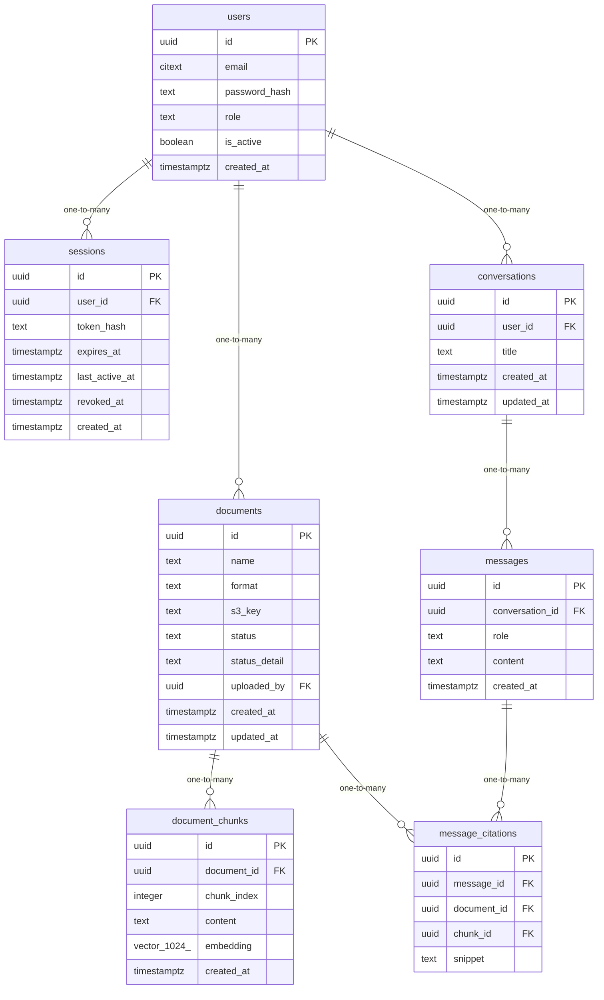

# Data Model

<!-- sdlc:auto:start entities -->
### users

| Field | Type | PK | FK | Nullable |
|---|---|---|---|---|
| id | uuid | True | — | False |
| email | citext | False | — | False |
| password_hash | text | False | — | False |
| role | text | False | — | False |
| is_active | boolean | False | — | False |
| created_at | timestamptz | False | — | False |

### sessions

| Field | Type | PK | FK | Nullable |
|---|---|---|---|---|
| id | uuid | True | — | False |
| user_id | uuid | False | users.id | False |
| token_hash | text | False | — | False |
| expires_at | timestamptz | False | — | False |
| last_active_at | timestamptz | False | — | False |
| revoked_at | timestamptz | False | — | True |
| created_at | timestamptz | False | — | False |

### documents

| Field | Type | PK | FK | Nullable |
|---|---|---|---|---|
| id | uuid | True | — | False |
| name | text | False | — | False |
| format | text | False | — | False |
| s3_key | text | False | — | False |
| status | text | False | — | False |
| status_detail | text | False | — | True |
| uploaded_by | uuid | False | users.id | False |
| created_at | timestamptz | False | — | False |
| updated_at | timestamptz | False | — | False |

### document_chunks

| Field | Type | PK | FK | Nullable |
|---|---|---|---|---|
| id | uuid | True | — | False |
| document_id | uuid | False | documents.id | False |
| chunk_index | integer | False | — | False |
| content | text | False | — | False |
| embedding | vector(1024) | False | — | False |
| created_at | timestamptz | False | — | False |

### conversations

| Field | Type | PK | FK | Nullable |
|---|---|---|---|---|
| id | uuid | True | — | False |
| user_id | uuid | False | users.id | False |
| title | text | False | — | True |
| created_at | timestamptz | False | — | False |
| updated_at | timestamptz | False | — | False |

### messages

| Field | Type | PK | FK | Nullable |
|---|---|---|---|---|
| id | uuid | True | — | False |
| conversation_id | uuid | False | conversations.id | False |
| role | text | False | — | False |
| content | text | False | — | False |
| created_at | timestamptz | False | — | False |

### message_citations

| Field | Type | PK | FK | Nullable |
|---|---|---|---|---|
| id | uuid | True | — | False |
| message_id | uuid | False | messages.id | False |
| document_id | uuid | False | documents.id | False |
| chunk_id | uuid | False | document_chunks.id | True |
| snippet | text | False | — | True |
<!-- sdlc:auto:end entities -->

<!-- sdlc:auto:start relationships -->
| Source | Target | Type |
|---|---|---|
| users | sessions | one-to-many |
| users | documents | one-to-many |
| users | conversations | one-to-many |
| documents | document_chunks | one-to-many |
| conversations | messages | one-to-many |
| messages | message_citations | one-to-many |
| documents | message_citations | one-to-many |
<!-- sdlc:auto:end relationships -->

<!-- sdlc:auto:start er-diagram -->

<!-- sdlc:auto:end er-diagram -->
