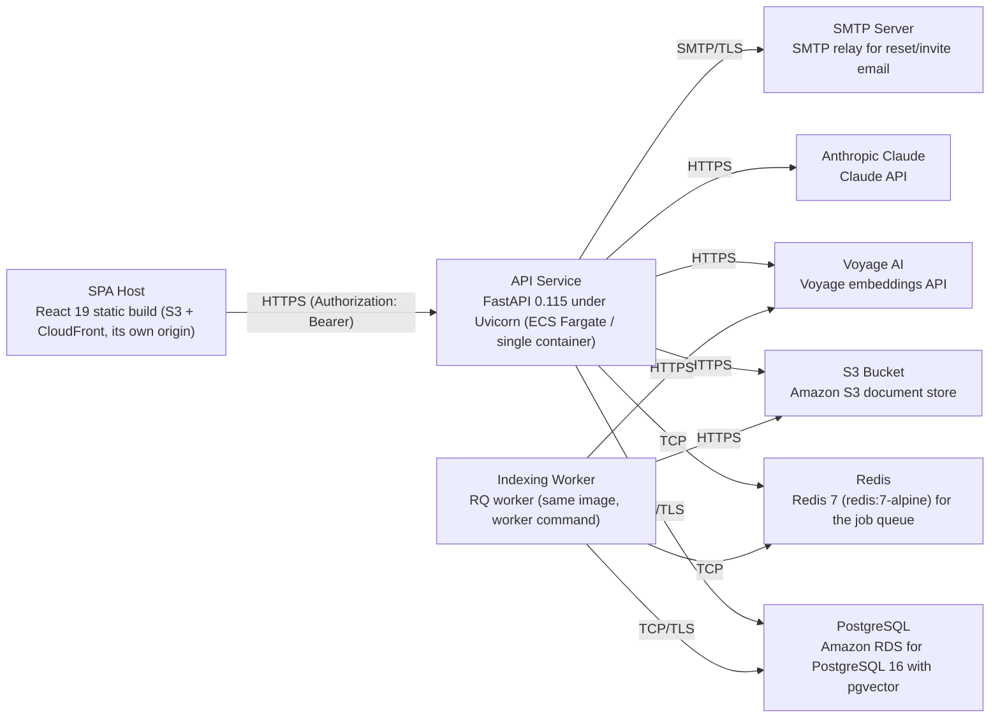

# Deployment Guide

> Maintained by QuorQ AI SDLC. Text between `sdlc:auto` markers is regenerated; anything outside them is yours and is kept.

<!-- sdlc:auto:start how-it-deploys -->
Pushes to `main` run `.github/workflows/deploy.yml`, which builds the API image (if there is a backend) and deploys the SPA to AWS Amplify. Commits touching only `docs/sdlc/**` don't deploy. Deployments can also be started from the platform's Deployment tab.
<!-- sdlc:auto:end how-it-deploys -->

<!-- sdlc:auto:start environments -->
| Name | Service | Runtime | Scaling | Environment |
|---|---|---|---|---|
| SPA Host | React 19 static build (S3 + CloudFront, its own origin) | Static assets | CDN-cached | dev |
| API Service | FastAPI 0.115 under Uvicorn (ECS Fargate / single container) | Python 3.12 | 1-2 small tasks for ~50 users | dev |
| Indexing Worker | RQ worker (same image, worker command) | Python 3.12 | 1 task | dev |
| PostgreSQL | Amazon RDS for PostgreSQL 16 with pgvector | PostgreSQL 16 | Single instance | dev |
| Redis | Redis 7 (redis:7-alpine) for the job queue | Redis 7 | Single node | dev |
| S3 Bucket | Amazon S3 document store | Managed | Managed | dev |
| Anthropic Claude | Claude API | External SaaS | Managed | dev |
| Voyage AI | Voyage embeddings API | External SaaS | Managed | dev |
| SMTP Server | SMTP relay for reset/invite email | External SaaS | Managed | dev |
<!-- sdlc:auto:end environments -->

<!-- sdlc:auto:start live -->
_Not deployed yet._
<!-- sdlc:auto:end live -->

<!-- sdlc:auto:start topology -->

<!-- sdlc:auto:end topology -->
