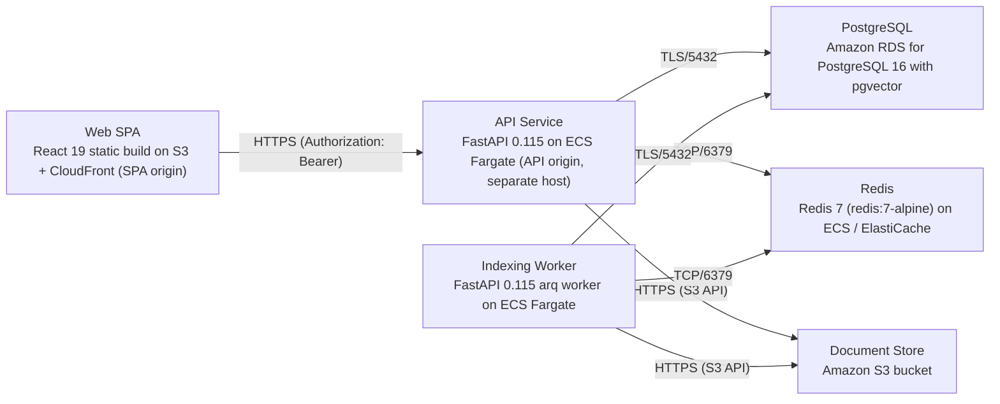

# Deployment Guide

> Maintained by QuorQ AI SDLC. Text between `sdlc:auto` markers is regenerated; anything outside them is yours and is kept.

<!-- sdlc:auto:start how-it-deploys -->
Pushes to `main` run `.github/workflows/deploy.yml`, which builds the API image (if there is a backend) and deploys the SPA to AWS Amplify. Commits touching only `docs/sdlc/**` don't deploy. Deployments can also be started from the platform's Deployment tab.
<!-- sdlc:auto:end how-it-deploys -->

<!-- sdlc:auto:start environments -->
| Name | Service | Runtime | Scaling | Environment |
|---|---|---|---|---|
| Web SPA | React 19 static build on S3 + CloudFront (SPA origin) | Static assets | CDN-cached, single bucket | dev |
| API Service | FastAPI 0.115 on ECS Fargate (API origin, separate host) | Python 3.12 / uvicorn | 1-2 small tasks for ~50 users | dev |
| Indexing Worker | FastAPI 0.115 arq worker on ECS Fargate | Python 3.12 | 1 task | dev |
| PostgreSQL | Amazon RDS for PostgreSQL 16 with pgvector | PostgreSQL 16 | single small instance, encryption at rest enabled | dev |
| Redis | Redis 7 (redis:7-alpine) on ECS / ElastiCache | Redis 7 | single node | dev |
| Document Store | Amazon S3 bucket | Object storage | managed, private bucket, server-side encryption | dev |
<!-- sdlc:auto:end environments -->

<!-- sdlc:auto:start live -->
_Not deployed yet._
<!-- sdlc:auto:end live -->

<!-- sdlc:auto:start topology -->

<!-- sdlc:auto:end topology -->
