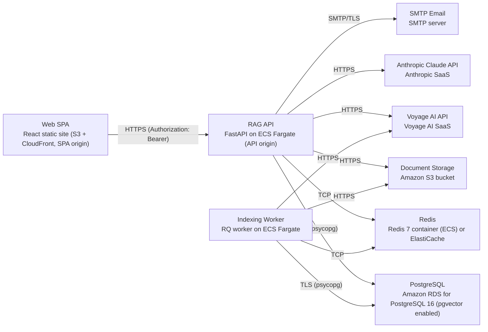

# Deployment Guide

> Maintained by QuorQ AI SDLC. Text between `sdlc:auto` markers is regenerated; anything outside them is yours and is kept.

<!-- sdlc:auto:start how-it-deploys -->
Pushes to `main` run `.github/workflows/deploy.yml`, which builds the API image (if there is a backend) and deploys the SPA to AWS Amplify. Commits touching only `docs/sdlc/**` don't deploy. Deployments can also be started from the platform's Deployment tab.
<!-- sdlc:auto:end how-it-deploys -->

<!-- sdlc:auto:start environments -->
| Name | Service | Runtime | Scaling | Environment |
|---|---|---|---|---|
| Web SPA | React static site (S3 + CloudFront, SPA origin) | Static assets | CDN-served, no app scaling | dev |
| RAG API | FastAPI on ECS Fargate (API origin) | Python 3.12 / Uvicorn | 1-2 tasks, sized for ~50 users | dev |
| Indexing Worker | RQ worker on ECS Fargate | Python 3.12 | 1 task | dev |
| PostgreSQL | Amazon RDS for PostgreSQL 16 (pgvector enabled) | PostgreSQL 16 | Single instance | dev |
| Redis | Redis 7 container (ECS) or ElastiCache | redis:7-alpine | Single node | dev |
| Document Storage | Amazon S3 bucket | S3 | Managed | dev |
| Anthropic Claude API | Anthropic SaaS | External | Managed by vendor | dev |
| Voyage AI API | Voyage AI SaaS | External | Managed by vendor | dev |
| SMTP Email | SMTP server | External | Managed | dev |
<!-- sdlc:auto:end environments -->

<!-- sdlc:auto:start live -->
_Not deployed yet._
<!-- sdlc:auto:end live -->

<!-- sdlc:auto:start topology -->

<!-- sdlc:auto:end topology -->
